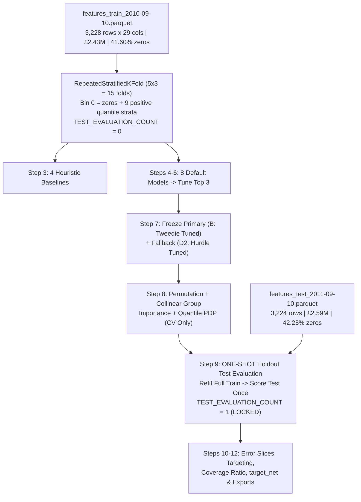

# Customer Intelligence Engine: Phase 4b Supervised 90-Day CLV Modeling & Evaluation Report

**Project**: Customer Intelligence Engine (RFM Segmentation + 90-Day CLV Regression)  
**Source Notebook**: [`5_clv_modeling_&_evaluation.ipynb`](../Notebooks/5_clv_modeling_&_evaluation.ipynb)  
**Production Module**: [`src/clv.py`](../src/clv.py) | **Unit Tests**: [`tests/test_clv.py`](../tests/test_clv.py)  
**Inputs**: `data/processed/features/features_train_2010-09-10.parquet`, `features_test_2011-09-10.parquet`, `segments_t_seg_2011-09-10.parquet` *(post-hoc diagnostics only)*, `sales_clean.parquet`, `returns_clean.parquet`  
**Execution Environment**: Python `3.12.10` (`.venv` with `scikit-learn 1.9.1`, `scipy 1.18.1`, `joblib 1.6.0`, `pandas 3.1.1`, `pytest 9.2.0`)  
**Status**: Completed, Frozen Before Test, Single-Shot Evaluated (`TEST_EVALUATION_COUNT = 1`), Unit-Tested (`55/55` Full Suite Passed), and Exported  
**Companion Phase 4a Report**: [`rfm_segmentation_report.md`](rfm_segmentation_report.md)

---

## Executive Summary

Phase 4b developed, benchmarked, interpreted, and evaluated an end-to-end **supervised 90-day gross Customer Lifetime Value (CLV) pipeline** under a zero-leakage validation contract (`TEST_EVALUATION_COUNT = 0` throughout model design, tuning, interpretation, and selection; incremented to `1` once on unseen `2011-09-10` holdout customers). Across **8 default `sklearn` model architectures** and **3 hyperparameter-tuned candidate families** trained strictly on `2010-09-10` (`3,228` customers), **`B: Tweedie GLM [Tuned]`** (`power=1.65`, `alpha=0.5`, log link, `Country top_n=3`) was frozen as primary over **`D2: Hurdle (Logit x Ridge) [Tuned]`** (documented fallback).

* **Holdout Test Ranking (`n = 3,224`, `£2,585,609.91`)**: Achieves **Spearman `0.5289`** `[0.5036, 0.5566]`, **Normalized Gini `0.7751`** `[0.6880, 0.8361]`, and **Top-10% Capture `56.12%` (`5.61x` Lift)** `[48.17%, 63.46%]` — capturing **`£1.45M`** by targeting just `322` customers (`92.55%` active buyer hit rate, `84.27%` of theoretical Oracle ceiling) and **`75.65%` (`£1.96M`)** at the Top 30% (`967` accounts).
* **Value Over Heuristic `Run-Rate`**: While historical `monetary * 90/270` (`Run-Rate`) statistically ties Tweedie on pure ordering (paired bootstrap CIs on Gini/Cap@10 cross zero), `Run-Rate` suffers a severe **`-37.38%` aggregate revenue under-forecast** (`-31.17%` even without Top-5 whales). Tweedie GLM improves total revenue calibration by **`+23.93pp` (`95% CI [+18.69pp, +29.88pp]`)** overall (`-13.45%` all, **`-0.96%` Excl Top-5 whales**), and cuts test decile mean absolute calibration error in half (**`£145.69` vs `£299.53`**).
* **Registered Q4 Coverage Ratio (`[2011-09-10, 2011-12-09)`)**: The `3,224` scored eligible customers generate **`80.96%` (`£2,585,609.91` / `£3,193,572.37`)** of all registered-customer Q4 gross sales (`80.88%` net), clearly separating out-of-scope cohorts: **Cold-Start new buyers (`12.06%`, `594` buyers)**, **Dormant-Reactivated (`6.98%`, `426` buyers)**, and **Returns-Only (`0.00%`, `6` accounts)**.
* **Robustness & Software Quality**: Conclusions remain unchanged under net-of-returns `target_net` (`Gini 0.7721`, `+24.60pp` paired calibration margin). All reusable metrics, pipelines, hurdle/smearing wrappers, permutation importance, bootstrap CIs, and targeting/coverage helpers live in [`src/clv.py`](../src/clv.py) and passed **`55 / 55` unit tests** (`pytest -v` in `52.00s`), with `0.00e+00` `joblib` roundtrip discrepancy.

### Exported Model & Analytical Artifacts

| Artifact | Location | Shape | Size | Role |
| :--- | :--- | :---: | :---: | :--- |
| [`clv_tweedie_tuned_2010_09_10.joblib`](../models/clv_tweedie_tuned_2010_09_10.joblib) | `models/` | Pipeline | `6.91 KB` | Frozen fitted `B: Tweedie GLM [Tuned]` production pipeline (`0.00e+00` roundtrip diff) |
| [`test_predictions_2011-09-10.parquet`](../data/processed/clv/test_predictions_2011-09-10.parquet) | `data/processed/clv/` | `3,224 × 11` | `137.84 KB` | Customer-ID test targets, predictions (`Tweedie`, `Run-Rate`, baselines), decile, segment, residual |
| `cv_leaderboard_5x3.{csv,parquet}` | `data/processed/clv/` | `14 × 26` | `2.91 / 18.98 KB` | Complete 5×3 train CV leaderboard across baselines, defaults & tuned candidates (`0` nulls) |
| `test_metrics_with_95ci.{csv,parquet}` | `data/processed/clv/` | `48 × 10` | `6.70 / 8.52 KB` | Test point estimates + 1,000-resample 95% CIs & paired delta vs `Run-Rate` |
| `test_whale_sensitivity.{csv,parquet}` | `data/processed/clv/` | `6 × 14` | `1.60 / 9.09 KB` | `All`, `Excl Top-1`, and `Excl Top-5` slices (`Tweedie` vs `Run-Rate`) |
| `test_segment_error_slices.{csv,parquet}` | `data/processed/clv/` | `5 × 19` | `1.86 / 12.49 KB` | Post-hoc Phase 4a segment error diagnostics |
| `targeting_simulation.{csv,parquet}` | `data/processed/clv/` | `12 × 10` | `1.83 / 7.63 KB` | Top 10%/20%/30% revenue capture simulation vs Random, Run-Rate, and Oracle |
| `coverage_ratio_2011q4.{csv,parquet}` | `data/processed/clv/` | `4 × 8` | `0.56 / 5.82 KB` | Q4 registered-customer revenue scope breakdown (`80.96%` eligible coverage) |
| `target_net_sensitivity.{csv,parquet}` | `data/processed/clv/` | `9 × 6` | `1.17 / 4.96 KB` | Gross `target` vs net `target_net` sensitivity table with 95% CIs |

---

## 1. Validation Contract, Input Audit & Whale Forensics (Steps 0–2)

### 1.1 Input Integrity, Customer Overlap & Stratification
* **Schema & Missingness Parity**: Exact column and dtype match between `train_df` (`3,228 × 29`) and `test_df` (`3,224 × 29`), unique `Customer ID` index, and structural nulls exclusively inside `mean_interpurchase_days` (`1,290 = 39.96%` train; `1,330 = 41.25%` test — matching `is_single_invoice == 1` identically).
* **Temporal Customer Overlap**: Out of `3,224` test accounts, **`1,855` (`57.54%`)** also appeared in train (`57.47%` of train), while **`1,369` (`42.46%`)** were acquired or reactivated post-`2010-09-10` and **`1,373`** train accounts turned inactive prior to `[2010-12-14, 2011-09-10)`.
* **Stratification Justification**: [`make_stratification_bins`](../src/clv.py#L59-L79) places exact zeros (`1,343` train rows) in Bin `0` and partitions positive targets into 9 equal quantile bins (Bin `9` spanning `£2,095.50–£79,192.85`), spreading wholesale extremes evenly across all `5 × 3 = 15` CV folds.

### 1.2 Forensic Whale Audit (Decision: Retain All Whales + Dual Reporting)
Top accounts drive substantial revenue concentration without entry-error signatures:
* **Pareto Share**: Train `Top 1 = 3.26%`, `Top 5 = 12.17%`, `Top 10 = 17.69%`; Test `Top 1 = 4.79%` (`ID 18102`, `£123,737.11`), `Top 5 = 17.26%`, `Top 10 = 22.64%`. Removing just Top-5 whales drops target standard deviation from `£2,979.94 -> £1,756.21` (train, skew `16.82 -> 9.06`) and `£4,097.15 -> £1,853.54` (test, skew `20.95 -> 8.98`).
* **Audit of `ID 18102` (`£123,737.11`)**: Verified in `sales_clean.parquet` across **`32` legitimate target-window invoices** (`267` order lines, `118` SKUs, `32,507` units, **`0` return/credit rows**) following a consistent `23`-invoice / `£107,616.14` lookback. Also noted surging test whale `14096` (`£203.89` across 3 invoices in lookback -> `£53,054.54` across 14 invoices in Q4).
* **Policy**: Retained all legitimate buyers intact and standardized dual evaluation metrics via `rmse_excl_top1`, `rmse_excl_top5`, and [`evaluate_whale_sensitivity_slices`](../src/clv.py).

---

## 2. Baselines, Duan Smearing & CV Model Selection (Steps 3–7)

### 2.1 Why Single-Stage `log1p(y)` Fails Under 42% Zero-Inflation
Evaluating [`Log1pSmearingRegressor`](../src/clv.py#L450-L490) on Train Fold 0 proved why retransforming single-stage `log1p(y)` predictions fails on zero-inflated CLV:

| Estimator (Fold 0 Probe) | Retransformation | Duan Factor $\hat{s}$ | Spearman | Norm Gini | Total Rev Err % | MAE (£) | RMSE (£) |
| :--- | :--- | :---: | :---: | :---: | :---: | :---: | :---: |
| `A1: Ridge (log1p)` | Naive `expm1` | `1.000` | 0.5000 | 0.7241 | **-66.13%** | 647.94 | 2,636.94 |
| `A1: Ridge (log1p)` | **Duan Smearing** | **`11.608`** | 0.5000 | 0.7241 | **+294.43%** | 2,799.41 | 11,887.75 |
| `C1: HistGBR (log1p)` | **Duan Smearing** | **`4.425`** | 0.4822 | 0.7178 | **+97.63%** | 1,312.36 | 4,770.54 |
| `D1-Stage2: HistGBR` *(`y > 0` only)* | Naive `expm1` | `1.000` | 0.6015 | 0.7959 | -23.51% | 817.99 | 2,969.68 |
| `D1-Stage2: HistGBR` *(`y > 0` only)* | **Duan Smearing** | **`1.064`** | 0.6015 | 0.7959 | **-18.61%** | 827.91 | 2,922.23 |

Because `41.6%` of customers sit at `log1p(0) = 0` while fitted log values center around `~3–4`, bimodal residuals inflate $\frac{1}{n}\sum \exp(\hat{\epsilon}_i)$ to **`4.43x–11.61x`** and multiply positive buyers upward into severe `+98%` to `+294%` budget explosions. Restricting `log1p` regression strictly to `y > 0` inside [`HurdleCLVRegressor`](../src/clv.py#L492-L545) keeps smearing tight and well-behaved (**`1.064x`**).

### 2.2 Complete `5 x 3` Train CV Leaderboard (`TEST_EVALUATION_COUNT = 0`)
*Tuning objective approved at Step 6: `ranking_capture_score = 0.5 * Normalized Gini + 0.5 * Top-10% Capture` (`RandomizedSearchCV`, `n_iter=12` per family on Top 3 candidates).*

| Model | Obj Score | Spearman | Norm Gini | Top-10% Cap (`Lift`) | Total Rev Err % | MAE (£) | MedAE (£) | RMSE All / Excl Top-5 (£) |
| :--- | :---: | :---: | :---: | :---: | :---: | :---: | :---: | :---: |
| `D2: Hurdle (Logit x Ridge) [Tuned]` | **0.6478** | **0.5068 ± 0.0224** | 0.7677 ± 0.0390 | **0.5279 ± 0.0521 (`5.28x`)** | -8.40% ± 9.21 | 561.7 ± 46.8 | 263.6 ± 10.9 | 1,763.6 / 790.0 |
| `D1: Hurdle (Shallow HistGB) [Tuned]` | 0.6467 | 0.5010 ± 0.0240 | **0.7704 ± 0.0360** | 0.5231 ± 0.0507 (`5.23x`) | -21.05% ± 9.75 | 606.0 ± 77.9 | 268.9 ± 13.6 | 2,420.8 / **766.4** |
| **`B: Tweedie GLM [Tuned]` *(Primary)*** | 0.6467 | 0.5013 ± 0.0237 | 0.7691 ± 0.0366 | 0.5242 ± 0.0540 (`5.24x`) | **-2.50% ± 10.51** | **554.4 ± 40.2** | 265.0 ± 10.4 | 1,629.6 / 834.1 |
| `B: Tweedie GLM (power=1.5, Default)` | 0.6462 | 0.4994 ± 0.0238 | 0.7687 ± 0.0365 | 0.5237 ± 0.0541 (`5.24x`) | -1.00% ± 10.80 | 556.8 ± 40.3 | 266.0 ± 10.9 | 1,649.5 / 849.7 |
| `Baseline (c): Run-Rate` *(== `Freq*AOV*90/270`)* | 0.6457 | 0.5060 ± 0.0197 | 0.7700 ± 0.0388 | 0.5214 ± 0.0515 (`5.21x`) | **-29.69% ± 6.40** | **527.1 ± 42.3** | **209.1 ± 8.7** | **1,599.2** / 825.3 |
| `D2: Hurdle (Logit x Ridge, Default)` | 0.6455 | 0.5021 ± 0.0224 | 0.7678 ± 0.0391 | 0.5231 ± 0.0539 (`5.23x`) | -1.17% ± 10.13 | 555.1 ± 38.3 | 263.7 ± 9.6 | 1,605.5 / 821.0 |
| `E: ExtraTrees (raw target check)` | 0.6387 | 0.5008 ± 0.0206 | 0.7657 ± 0.0353 | 0.5116 ± 0.0494 (`5.12x`) | +0.19% ± 11.87 | 591.7 ± 50.6 | 260.9 ± 8.6 | 1,963.5 / 913.1 |
| `D1 / A2 / C2 / A1 / C1` (remaining 5) | 0.5888–0.6281 | 0.4525–0.5119 | 0.6849–0.7473 | 0.4928–0.5091 | -13.40% to +280.34% | 568.2–2,406.9 | 246.4–352.0 | 1,940–11,427 |
| `Baseline (a) Train Mean / (b) Median` | 0.0500 | 0.0000 | 0.0000 | 0.1000 (`1.00x`) | +1.48% / -70.17% | 889.3 / 728.3 | 752.8 / 222.0 | 2,825.6 / 2,875.0 |

### 2.3 Why `B: Tweedie GLM [Tuned]` Was Frozen Over `D2` & `D1` (Step 7 Decision)
* **OOF Decile Calibration**: Across all 10 CV deciles, **`B: Tweedie GLM [Tuned]`** achieved a decile mean absolute calibration error of **`£57.17`** (`pred/actual` ratios tightly within **`0.90–1.16`**, Decile 10 **`0.917`**), cutting `D2 [Tuned]`'s error (`£121.32`, Decile 10 `0.783`) in half and `D1 [Tuned]`'s error (`£191.48`, Decile 10 flat-capped at `0.589`) by over 3x.
* **Paired 15-Fold Noise Check (`D2 [Tuned]` minus `B [Tuned]`)**: Differences in `top_10_capture` (`+0.0036 ± 0.0104`, 10/15 folds) and `normalized_gini` (`-0.0014 ± 0.0048`, 6/15 folds) were inside fold noise, while `B [Tuned]` beat `D2 [Tuned]` on overall `RMSE` (`11/15` folds), `MAE`, and budget bias (`-2.50%` vs `-8.40%`), without needing Stage-2 Ridge `alpha=200` shrinkage or smearing. *(Note: `D2 [Tuned]` excelled on core non-whales, `rmse_excl_top5 = £790.0` in 14/15 folds, and Stage-1 `LogisticRegression` achieved strong binary discrimination: `PR-AUC = 0.8006 ± 0.0088`, `ROC-AUC = 0.7283 ± 0.0120`, `ECE = 0.0345 ± 0.0106`.)*

---

## 3. CV Feature Interpretation & Collinearity Analysis (Step 8)

Using [`cv_permutation_importance`](../src/clv.py#L720-L815) (`15 folds × 10 repeats`) on both single features and [`CLV_FEATURE_GROUPS`](../src/clv.py#L680-L717):

| Business Block (`CLV_FEATURE_GROUPS`) | # Cols | Primary `B` Joint Gini Drop | Sum of Single Drops | Collinearity Dilution (`Joint / Sum`) | Top-10% Cap Drop | Spearman Drop | MAE Inc (£) | Fallback `D2` Gini Drop |
| :--- | :---: | :---: | :---: | :---: | :---: | :---: | :---: | :---: |
| **`Basket Size & Pricing`** | 3 | **0.0775 ± 0.0147** | 0.0475 | **1.63x** | +0.0401 | +0.0735 | +£81.18 | **0.0843 ± 0.0137** |
| **`Frequency & Cadence`** | 5 | **0.0674 ± 0.0201** | 0.0201 | **3.36x** | **+0.0670** | **+0.0957** | **+£120.44** | **0.0628 ± 0.0179** |
| `Historical Monetary & Assortment` | 2 | 0.0265 ± 0.0046 | 0.0320 | 0.83x | +0.0146 | +0.0359 | +£56.42 | 0.0204 ± 0.0062 |
| `Recency & Recent Momentum` | 8 | 0.0039 ± 0.0033 | 0.0034 | 1.16x | +0.0051 | +0.0102 | +£20.31 | 0.0077 ± 0.0058 |
| `Returns & Refunds` | 4 | 0.0018 ± 0.0022 | 0.0118 | **0.15x** | +0.0055 | +0.0042 | +£14.15 | 0.0015 ± 0.0026 |
| `Tenure & Geography` | 4 | 0.0005 ± 0.0015 | 0.0010 | 0.48x | +0.0007 | -0.0012 | +£0.47 | -0.0005 ± 0.0019 |

* **Collinearity Dilution Proof**: Single-feature `frequency` drops Gini by only `0.0153` because L2 `alpha=0.5` distributes signal across `n_active_months`, `n_active_weeks`, `mean_interpurchase_days`, and `is_single_invoice`. Permuted jointly, **`Frequency & Cadence` surges `3.36x`** to become **#1 on Top-10% Capture (`0.0670`), Spearman (`0.0957`), and MAE (`+£120.44`)**.
* **Directional GLM Elasticities & Quantile PDP**: Base Tweedie intercept is `£390.07` (`exp(5.9663)`). Key +1 SD multipliers (`exp(beta)`) are `monetary = 1.302x`, `aov = 1.300x`, `frequency = 1.207x`, `avg_items_per_invoice = 1.176x`, `mean_interpurchase_days = 0.922x`, and `return_rate = 0.950x` (note `return_value_abs` shows `+0.1547` merely as a gross wholesale volume proxy and cancels normalized return friction jointly). Across observed train quantiles (`q10 -> q90`), `aov` lifts PDP **`+£364.21`** (`£447 -> £811`) and `monetary` lifts **`+£349.81`** (`£386 -> £735`), while `recency_days` slopes gently downward (`-£25.96`) since all rows already satisfy `recency <= 270d`. Country multipliers stay nearly neutral (`0.966x` Netherlands to `1.032x` Other).

---

## 4. Holdout Test Evaluation, Bootstrap CIs & Error Slices (Steps 9–10)

### 4.1 One-Shot Holdout Test Results (`n = 3,224`, 1,000 Customer Bootstrap Resamples)

| Model / Slice | Spearman `[95% CI]` | Norm Gini `[95% CI]` | Top-10% Cap `[95% CI]` | Total Rev Err % `[95% CI]` | MAE (£) `[95% CI]` | RMSE All / Excl Top-1 / Excl Top-5 (£) |
| :--- | :---: | :---: | :---: | :---: | :---: | :---: |
| **`B: Tweedie GLM [Tuned]` (All)** | **0.5289** `[0.504, 0.557]` | **0.7751** `[0.688, 0.836]` | **0.5612 (`5.61x`)** `[0.482, 0.635]` | **-13.45%** `[-23.47%, -1.44%]` | 600.1 `[506.2, 705.8]` | 3,107.6 / 2,454.4 / **1,241.5** |
| `Baseline (c): Run-Rate` (All) | 0.5315 `[0.506, 0.560]` | 0.7719 `[0.672, 0.839]` | 0.5590 (`5.59x`) `[0.478, 0.633]` | **-37.38%** `[-43.07%, -30.08%]` | **563.4** `[475.3, 651.7]` | **2,792.8** / **2,325.3** / 1,259.8 |
| `Baseline (a): Train Mean` (£752.81) | 0.0000 | 0.0000 | 0.1000 (`1.00x`) | -6.13% `[-20.45%, +11.97%]` | 953.6 `[830.2, 1,095.7]` | 4,096.8 / 3,478.0 / 1,855.3 |
| `Baseline (b): Train Median` (£222.08) | 0.0000 | 0.0000 | 0.1000 (`1.00x`) | -72.31% `[-76.53%, -66.97%]` | 784.1 `[657.9, 925.4]` | 4,137.4 / 3,519.9 / 1,905.3 |
| *Sensitivity*: **`B [Tuned]` Excl Top-5 (`n=3,219`)** | `0.5278` | `0.7604` | `0.4964 (4.96x)` | **`-0.96%`** *(`RR: -31.17%`)* | `499.4` *(`RR: 471.2`)* | RMSE: **`1,241.5`** *(`RR: 1,259.8`)* |

* **Paired Difference Significance (`Tweedie - Run-Rate`)**: Ranking metrics statistically tie (`delta_gini = +0.0032 [-0.0052, +0.0161]`, `delta_cap10 = +0.0022 [-0.0048, +0.0096]`), whereas **`total_rev_error_pct` improves by `+23.93pp` (`95% CI [+18.69pp, +29.88pp]`, excludes zero)** and decile calibration MAE drops from `£299.53` to **`£145.69`**.

### 4.2 Diagnostic Error Analysis Highlights (`Step 10`, Post-Hoc Slices)

| Diagnostic Cohort | `n` | Test Share % | Actual Mean (£) | Tweedie Pred Mean (£) | Tweedie Rev Err % | Run-Rate Rev Err % | Within-Cohort Spearman | Key Mechanism |
| :--- | :---: | :---: | :---: | :---: | :---: | :---: | :---: | :--- |
| **`VIP Champions`** | 473 | 60.16% | 3,288.58 | 2,446.74 | -25.60% | -38.05% | **0.63** (`Gini 0.87`) | Log-log compression on high-AOV VIPs (`18102`, `17450`) |
| **`Loyal Regulars`** | 1,208 | 25.95% | 555.33 | **556.12** | **+0.14%** | -31.76% | 0.34 | Near-exact aggregate & decile calibration |
| **`Promising Recent Buyers`** | 1,024 | 10.85% | 273.84 | **281.99** | **+2.98%** | -52.02% | 0.23 | Clean calibration; `RMSE £1,699` skewed by outlier `14096` |
| `At-Risk Repeaters` | 357 | 2.71% | 196.08 | 266.81 | **+36.07%** | -24.25% | 0.02 | `63.03%` zeros; weak recency decay over-predicts |
| `Hibernating / Lost` | 162 | 0.34% | 54.67 | 152.43 | **+178.82%** | +15.78% | 0.03 | `80.86%` zeros; log-linear intercept props up churners |
| `Lookback Top-1% (>=£13,049)` | 33 | 30.72% | 24,066.87 | 14,578.81 | -39.42% | -40.68% | 0.51 | Ex-ante whales compressed; **30/33 (`90.9%`) in Decile 10** |
| `Lookback Bottom 90% Core` | 2,901 | 44.09% | 393.00 | **394.19** | **+0.30%** | -41.00% | 0.42 | Virtually zero aggregate error across core 90% base |
| `Repeat` / `Single-Invoice` | 1,894 / 1,330 | 88.1% / 11.9% | 1,202 / 232 | 1,002 / 256 | -16.7% / +10.6% | -35.8% / -49.0% | 0.57 / 0.16 | Single-invoice buyers lack cadence signal (`61.8%` zeros) |
| `UK` / `Export (Non-UK)` | 2,899 / 325 | 83.1% / 16.9% | 741 / 1,343 | 631 / 1,261 | -14.9% / -6.1% | -39.4% / -27.4% | 0.53 / **0.58** | Export accounts (`14646`, `14911`) rank very cleanly (`Gini 0.89`) |
| `Seen in Train` / `New to Train` | 1,855 / 1,369 | 73.9% / 26.2% | 1,029 / 494 | 885 / 435 | -14.0% / -11.9% | -35.3% / -43.3% | **0.58** / 0.42 | Generalizes cleanly to unseen 2011 buyers |

* **SSE Concentration & Decile 3 Anomaly**: Just **5 accounts (`0.16%`) produce `84.1%` of total Test SSE** (Top 10 = `90.0%`), led by under-predicted VIPs `18102` (`-£108.3k`), `17450` (`-£93.2k`), surging buyer `14096` (`-£52.8k`, `lookback = £203.89` -> `Q4 = £53,054.54`, responsible for `Decile 3`'s apparent `£334.49` mean vs `£0.00` median), `14646` (`-£49.0k`), and `14911` (`-£23.9k`), while largest over-prediction came from shrinking VIP `14156` (`+£21.5k`) and return-heavy churned buyer `15749` (`£44.5k, return_rate=0.25 -> £0 actual vs £10.3k pred`).

---

## 5. Business Translation, Coverage & Honest Limitations (Steps 11–12)

### 5.1 Marketing Targeting Simulation & Q4 Registered Coverage Ratio
* **Outreach Yield (`n = 3,224`, `£2,585,609.91`)**:
  * **Top 10% (`322` buyers)**: Tweedie captures **`£1,451,152` (`56.12%`, `5.61x` lift, `84.27%` of Oracle `£1.72M`)** with **`92.55%` active buyer hit rate** (vs `90.06%` for Run-Rate).
  * **Top 20% (`645` buyers)**: Captures **`£1,738,883` (`67.25%`, `3.36x` lift, `83.04%` of Oracle)**, `86.67%` active rate.
  * **Top 30% (`967` buyers)**: Captures **`£1,955,926` (`75.65%`, `2.52x` lift, `84.15%` of Oracle)** — isolating over three-quarters of eligible revenue while saving outreach on 70% of the base.
* **Registered-Customer Coverage Ratio (`[2011-09-10, 2011-12-09)` Total = `£3,193,572.37` gross across `2,910` active registered buyers)**:
  * **Scored Eligible Base (`3,224` pool, `1,884` Q4 active)**: **`80.96%` gross (`£2,585,609.91`)** / `80.88%` net (`£2,514,250.85`).
  * **Out-of-Scope Cold-Start (`594` new buyers)**: **`12.06%` gross (`£385,089.91`)** — requires separate post-first-order onboarding logic.
  * **Out-of-Scope Dormant-Reactivated (`426` accounts)**: **`6.98%` gross (`£222,872.55`)** — pre-`2010-12-14` buyers waking up in Q4.
  * **Out-of-Scope Returns-Only (`6` accounts)**: `0.00%` gross / `-£624.59` net (`-0.02%`).

### 5.2 Returns Sensitivity (`target_net`) & Known Limitations
* **Net-of-Returns Check (`target_net = £2,514,250.85`, `£71.4k` returns, `28` net `< 0` rows)**: Conclusions do **not** change — `Spearman = 0.5166`, `Gini = 0.7721`, `Top-10% = 56.01%`, net revenue error tightens to `-10.99%` (`+24.60pp` paired advantage over Run-Rate's `-35.60%`, `Excl Top-5 = +2.15%`).
* **Honest Production Limitations**:
  1. **Single train/test cutoff pair (`2010-09-10` -> `2011-09-10`)**: Does not measure multi-year macro shifts across more than two years.
  2. **Q4 seasonal scope (`Sep 10 – Dec 09`)**: Learns Q4 expansion; deploying for Q1–Q3 requires retraining on spring/summer horizons.
  3. **Extreme B2B wholesale heavy tail**: 5 accounts generate `17.26%` of spend and `84.1%` of SSE; high-AOV key accounts require human account-manager overrides on top of automated ranking.
  4. **Fixed `270`-day active registered scope**: Covers `80.96%` of registered Q4 revenue while excluding cold-start (`12.06%`), dormant >270d (`6.98%`), and unauthenticated `guest_transactions` (`227,089` rows).

