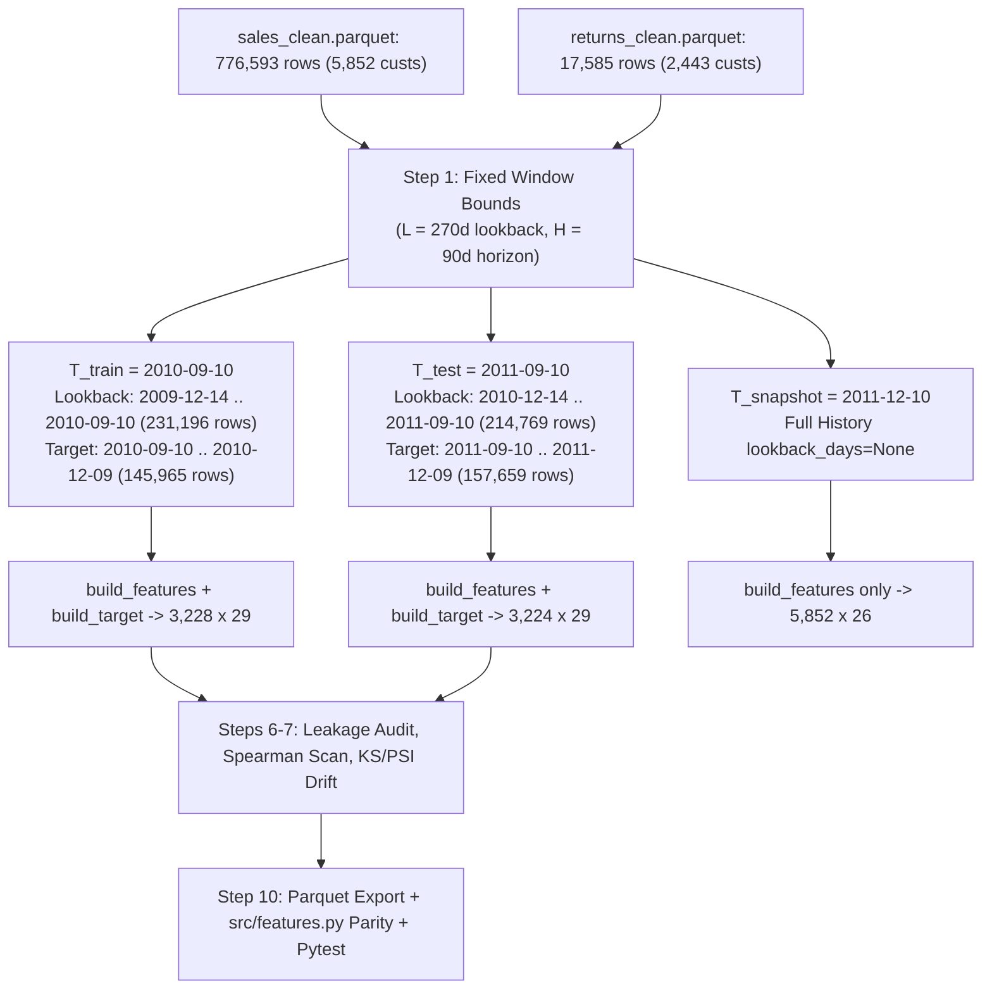

# Customer Intelligence Engine: Phase 3 Cutoff Design & Feature Engineering Report

**Project**: Customer Intelligence Engine (RFM Segmentation + 90-Day CLV Regression)  
**Source Notebook**: [`3_cutoff_design_&_feature_engineering.ipynb`](file:///c:/Users/mosa/Desktop/Projects/Customer-Intelligence-Engine/Notebooks/3_cutoff_design_&_feature_engineering.ipynb)  
**Production Module**: [`src/features.py`](file:///c:/Users/mosa/Desktop/Projects/Customer-Intelligence-Engine/src/features.py) | **Unit Tests**: [`tests/test_features.py`](file:///c:/Users/mosa/Desktop/Projects/Customer-Intelligence-Engine/tests/test_features.py)  
**Inputs (`data/processed/`)**: `sales_clean.parquet` (`776,593 x 13`) + `returns_clean.parquet` (`17,585 x 13`)  
**Execution Environment**: Python `3.12.10` (`.venv` with `pandas 3.1.1`, `pyarrow 26.0.1`, `scipy 1.18.1`, `scikit-learn 1.9.1`, `pytest 9.2.0`)  
**Status**: Completed, Leakage-Audited, Unit-Tested (`15/15` passed), and Exported to Parquet  
**Next Phase**: Phase 4 — RFM Customer Segmentation & 90-Day CLV Modeling (`sklearn` Pipelines)

---

## Executive Summary

Phase 3 converted transaction-level retail ledgers into **leak-free, customer-level supervised learning tables** (`features_train_2010-09-10.parquet`, `features_test_2011-09-10.parquet`) and a separate **descriptive RFM segmentation snapshot** (`rfm_snapshot_2011-12-10.parquet`). Using two seasonally aligned temporal cutoffs (`2010-09-10` and `2011-09-10`) combined with a fixed **270-day lookback window** and **90-day future gross-spend horizon**, the design guarantees identical feature semantics across cohorts and prevents temporal, preprocessing, or return-target contamination.

### Exported Feature Artifacts (`data/processed/features/`)

| Parquet Artifact | Cutoff $T$ | Lookback Window | Rows | Cols | Disk Size | Cohort Role | Zero-Target Share | Target Skewness |
| :--- | :---: | :---: | :---: | :---: | :---: | :--- | :---: | :---: |
| **`features_train_2010-09-10.parquet`** | `2010-09-10 00:00` | `270d` `[2009-12-14, 2010-09-10)` | **3,228** | `29` | `0.284 MB` (`298,105` B) | Temporal training set (`26` features + `3` targets) | **41.60%** (`1,343` zeros) | `16.82` |
| **`features_test_2011-09-10.parquet`** | `2011-09-10 00:00` | `270d` `[2010-12-14, 2011-09-10)` | **3,224** | `29` | `0.282 MB` (`295,452` B) | Out-of-time test set (`26` features + `3` targets) | **42.25%** (`1,362` zeros) | `20.95` |
| **`rfm_snapshot_2011-12-10.parquet`** | `2011-12-10 00:00` | Full 24m (`None`) | **5,852** | `26` | `0.471 MB` (`493,590` B) | Descriptive full-history RFM segmentation only | *N/A* | *N/A* |

* **Zero Temporal Leakage**: Every predictive feature uses strictly `InvoiceDate < T`, while targets use `T <= InvoiceDate < T + 90d` (`target_end = Dec 9 00:00`, automatically dropping `604` partial-day transactions on `2011-12-09 00:00–12:50`).
* **Remarkable Cohort Stability**: Across all **25 numeric features**, **0 / 25** showed notable covariate drift between `T_train` and `T_test` (`PSI` `0.0000–0.0199`; `KS <= 0.0443`), proving the effectiveness of aligned seasonal cutoffs and fixed `L = 270d` lookbacks.
* **Production Code Parity & Test Coverage**: All notebook logic was extracted identically into [`src/features.py`](file:///c:/Users/mosa/Desktop/Projects/Customer-Intelligence-Engine/src/features.py), cross-checked via `pd.testing.assert_frame_equal`, and verified by **15 passing pytest cases** (`10` in [`test_data_utils.py`](file:///c:/Users/mosa/Desktop/Projects/Customer-Intelligence-Engine/tests/test_data_utils.py) + `5` in [`test_features.py`](file:///c:/Users/mosa/Desktop/Projects/Customer-Intelligence-Engine/tests/test_features.py)).

---

## 1. Strict Phase 3 Scope & Temporal Architecture

This phase **exclusively** designs temporal cutoffs, builds deterministic customer-level features and future targets, audits leakage/drift, and exports raw unscaled tables.

### Interview Defense: Why Keep `NaN`s & Defer Scaling, Encoding, and Log Transforms?
1. **No Fitting Before Phase 4**: Fitting scalers (`StandardScaler`, `RobustScaler`), quantile transformers, imputers, or target/one-hot encoders (`country`) before Phase 4 would leak validation/test distributions or lock a single preprocessing choice. All fitting-based transformations belong inside downstream `sklearn` `Pipeline` and `ColumnTransformer` objects fit **only on training folds**.
2. **Meaningful Structural `NaN`s**: Single-invoice buyers (`~40%` train, `~41%` test) do not have a defined `mean_interpurchase_days`. Imputing `0` falsely implies instantaneous daily reordering, whereas imputing a median outside a pipeline leaks fold statistics. Leaving `mean_interpurchase_days = NaN` alongside `is_single_invoice` preserves exact truth for tree models (native missing handling) and pipeline-based linear imputation.

---

## 2. Temporal Cutoff & Target Design Decisions (Steps 0–2)

### 2.1 Aligned Seasonal Cutoffs (`T_train = 2010-09-10`, `T_test = 2011-09-10`)
* **Input Baseline (Step 0)**: Confirmed `0` nulls in `Customer ID` across `sales_clean.parquet` (`2009-12-01 07:45` to `2011-12-09 12:50`, `£16,783,959.54`) and `returns_clean.parquet` (`2009-12-01 10:33` to `2011-12-09 11:58`, `-£464,336.83`, `23` returns-only accounts out of `5,875` total registered accounts). `guest_transactions.parquet` (`227,089` rows) and `admin_rows.parquet` (`5,801` rows) remain isolated and unused.
* **Why Same Calendar Dates (`Sep 10 -> Dec 9`)?** Retail demand surges sharply in Q4. Evaluating a `Sep-Dec` test window on a model trained on a `Spring/Summer` target would confound model error with seasonal shift. Aligning both target windows strictly inside `[Sep 10, Dec 9)` gives identical Q4 seasonality across `train` and `test`. Consequently, **no Q4 seasonality feature is engineered** because it is constant (`1`) across both target windows by construction.
* **Boundary Contract**: Cutoffs are half-open exclusive boundaries (`features < T`, `T <= target < T + 90d`). Because `T_test + 90d = 2011-12-09 00:00:00`, all **`604` partial-day rows** recorded on `2011-12-09` (`00:00` to `12:50`) are automatically excluded.

### 2.2 Fixed Lookback Window (`L = 270` Days) & Eligibility Audit (Step 2)
* **Why Fix `L = 270` Rather Than Expanding History?** From dataset start (`2009-12-01`) to `T_train` (`2010-09-10`), only ~`283` days of history exist, whereas `T_test` (`2011-09-10`) has ~`648` days. Using unbounded expanding history would give test customers twice as long to accumulate `frequency`, `monetary`, and `tenure`, manufacturing artificial covariate drift. Fixing `L = 270` days (`~9` months) ensures identical maximum accumulation across both splits.
* **Eligibility Rule**: A customer is eligible at cutoff $T$ iff they have **$\ge 1$ row in `sales_clean` inside `[T - 270d, T)`**. Customers with only returns or inactive before `T - 270d` are excluded, defining the model's exact operating scope.

| Metric at Cutoff $T$ (`L = 270d`) | `T_train` (`2010-09-10`) | `T_test` (`2011-09-10`) | Analytical Takeaway |
| :--- | :---: | :---: | :--- |
| **Registered Customers Before $T$** | `3,383` | `5,280` | Customer base grew by `+1,897` buyers across Year 2 |
| **Eligible Customers (`>= 1` Sale in `[T-270d, T)`)** | **`3,228`** (`95.42%`) | **`3,224`** (`61.06%`) | Nearly identical active cohort size (`~3,225`) under fixed 9m window |
| **Excluded Total Before $T$** | `155` | `2,056` | Year 2 includes prior-year churned & annual-seasonal cohorts |
| — *Returns-only inside `[T-270d, T)`* | `26` (`12` bought in target, `14` did not) | `33` (`13` bought in target, `20` did not) | Small edge cohort lacking a historical gross purchase anchor |
| — *No activity inside `[T-270d, T)`* | `129` (`41` bought in target, `88` did not) | `2,023` (`413` bought in target, `1,610` did not) | `413` dormant Year-1 buyers reactivated in Q4 2011 (e.g., annual Q4 shoppers) |
| **Eligible Active in Target `[T, T+90d)`** | `1,885` (`58.40%`) | `1,862` (`57.75%`) | Nearly identical active repeat conversion (`~58%`) |
| **Cold-Start Buyers First Appearing in Target** | `922` | `594` | New accounts without lookback history; out of scope for history-based CLV |

### 2.3 Target Definition (`target`, `target_net`, `target_active`)
* **Primary Target (`target`)**: Sum of gross `TotalPrice` strictly from `sales_clean` inside `[T, T + 90d)`, left-joined onto `eligible_ids` with `0.0` fill (`target >= 0`).
  * **Why Gross Sales Instead of Net Sales?** Prior-window returns often get posted weeks or months later inside the next quarter (`+28d` to `+97d` observed in Phase 2). Netting returns inside the target window creates negative CLV targets (`32` customers in train, `28` in test had `target_net < 0`), penalizing a customer's future spend for an old order cancellation. Instead, returns are captured **historically** as predictive friction features (`[T - 270d, T)`), while **`target_net`** (`sales + returns`) and **`target_active`** (`1` if `target > 0` else `0`) are stored for Phase 4 sensitivity checks and Hurdle classification models.

---

## 3. Feature Catalog & Engineering Rationale (Steps 3–5)

We engineered **26 features** organized into **6 behavioral groups** cleanly inside [`build_features`](file:///c:/Users/mosa/Desktop/Projects/Customer-Intelligence-Engine/src/features.py#L48-L166), using only transactions in `[T - L, T)`.

| Group | Feature Name | Definition in `[T - L, T)` | Analytical & Business Reasoning |
| :--- | :--- | :--- | :--- |
| **Core RFM (3)** | `recency_days` | `(T - max(InvoiceDate))` in continuous days | Primary exponential decay / churn hazard predictor |
| | `frequency` | `nunique(Invoice)` in `sales` | Repeat engagement count and purchasing habit strength |
| | `monetary` | `sum(TotalPrice)` in `sales` | Total 270-day historical gross spending power |
| **Behavior (6)** | `aov` | `monetary / frequency` | Separates large-basket B2B buyers from frequent small buyers |
| | `avg_items_per_invoice` | `sum(Quantity) / frequency` | Distinguishes bulk pack wholesalers from single-item buyers |
| | `avg_unit_price` | `monetary / sum(Quantity)` | Quantity-weighted price tier preference across merchandise |
| | `n_unique_products` | `nunique(StockCode)` in `sales` | Catalog adoption breadth; multi-SKU accounts retain better |
| | `n_active_months` | `nunique(year_month)` in `sales` | Distinguishes steady multi-month buyers from one-month bursts |
| | `n_active_weeks` | `nunique(ISO year-week)` in `sales` | Finer-grained weekly purchasing regularity (`39`-week lookback) |
| **Timing (4)** | `tenure_days_in_window` | `(T - min(InvoiceDate))` in days | Account age observed inside lookback (left-censored at `L = 270d`) |
| | `is_tenure_at_edge` | `1` if `tenure_days_in_window >= L - 7` else `0` (`0` if `L is None`) | Flags accounts hitting the left lookback boundary (`358` train, `316` test) |
| | `mean_interpurchase_days` | `(last_dt - first_dt) / (frequency - 1)` if `freq > 1` else `NaN` | Average days between orders; preserves `NaN` for single-invoice buyers |
| | `is_single_invoice` | `1` if `frequency == 1` else `0` | Explicit structural indicator paired with `mean_interpurchase_days` (`NaN`) |
| **Recent Trend (7)** | `spend_last_30d`, `60d`, `90d` | `sum(TotalPrice)` in `[T - w, T)` for `w in {30, 60, 90}` | Captures short- and medium-term spend acceleration right before $T$ |
| | `invoices_last_30d`, `60d`, `90d` | `nunique(Invoice)` in `[T - w, T)` for `w in {30, 60, 90}` | Captures recent purchase cadence leading into cutoff $T$ |
| | `spend_last_90d_ratio` | `spend_last_90d / monetary` | Momentum share (`1.0` = all recent vs `0.0` = cooling off over last 90d) |
| **Returns (4)** | `return_invoice_count` | `nunique(Invoice)` in `returns` | Count of historical cancellation invoices in lookback |
| | `return_value_abs` | `abs(sum(TotalPrice))` in `returns` | Gross sterling value reversed via lookback returns |
| | `return_value_ratio` | `return_value_abs / monetary` | Fraction of gross sales canceled (return friction / net realization risk) |
| | `return_rate` | `return_invoice_count / (frequency + return_invoice_count)` | Proportion of total historical invoices ending in cancellation |
| **Geography (2)** | `is_uk` | `1` if latest `Country == 'United Kingdom'` else `0` | Domestic retail vs international export/B2B shipping profile |
| | `country` | Latest `Country` sorted by `InvoiceDate, Invoice` | Raw destination label keeping `'Unspecified'` explicit (`2` train / `6` test changed country inside lookback) |

### Risky / Collinear Features Retained Intentionally
Several features carry high structural Spearman collinearity on `train_df` (`|rho| >= 0.80`): e.g. `spend_last_30d` & `invoices_last_30d` (`0.9839`), `n_active_months` & `n_active_weeks` (`0.9829`), `return_value_abs` & `return_value_ratio` (`0.9759`), `return_invoice_count` & `return_value_abs` (`0.9743`), `frequency` & `n_active_weeks` (`0.9742`), `frequency` & `n_active_months` (`0.9566`), `spend_last_60d` & `invoices_last_60d` (`0.9545`), and `spend_last_90d` & `invoices_last_90d` (`0.9287`). In addition, `tenure_days_in_window` is left-censored at `270` days (`is_tenure_at_edge` marks `11.1%` train / `9.8%` test).  
**Why keep them all?** Tree-based models (`LightGBM`, `XGBoost`, `HistGradientBoostingRegressor`) handle collinear ratios and cumulative sums cleanly while benefiting from multi-scale splits; regularized linear/Ridge/Tweedie baselines in Phase 4 can select or penalize subsets inside their own `Pipeline`.

---

## 4. Verification, Unit Testing & Leakage Audit (Steps 4–6)

### 4.1 Hard Boundary Assertions & Unit Tests
Both [`build_features`](file:///c:/Users/mosa/Desktop/Projects/Customer-Intelligence-Engine/src/features.py#L69-L85) and [`build_target`](file:///c:/Users/mosa/Desktop/Projects/Customer-Intelligence-Engine/src/features.py#L187-L212) enforce loud runtime assertions (`max(InvoiceDate) < cutoff`, `min(InvoiceDate) >= cutoff - lookback`, `target >= 0`, `target_active == (target > 0)`), backed by deterministic synthetic fixture tests in both Notebook Step 4/5 and [`tests/test_features.py`](file:///c:/Users/mosa/Desktop/Projects/Customer-Intelligence-Engine/tests/test_features.py). Running `pytest -v` after Phase 3 completion passed **15 / 15 tests** in `0.34s`.

### 4.2 Three-Pronged Leakage Audit Results (Step 6)
1. **Timestamp Window Verification**:
   * `train_df` (`T_train = 2010-09-10`): feature transactions span `2009-12-14 08:40:00` to **`2010-09-09 20:03:00`** (`< T_train`); target transactions span **`2010-09-10 08:50:00`** to **`2010-12-08 17:20:00`** (`< 2010-12-09`).
   * `test_df` (`T_test = 2011-09-10`): feature transactions span `2010-12-14 09:26:00` to **`2011-09-09 16:36:00`** (`< T_test`); target transactions span **`2011-09-11 10:35:00`** to **`2011-12-08 20:01:00`** (`< 2011-12-09`).
2. **Spearman Correlation Scan Against `target`**: Zero features exceeded `|rho| > 0.95`. Highest observed correlations were economically plausible historical signals: `monetary` (`0.5065` train, **`0.5315`** test), `n_active_weeks` (`0.4657` / `0.4974`), `frequency` (`0.4594` / `0.4960`), `n_active_months` (`0.4638` / `0.4949`), `n_unique_products` (`0.4149` / `0.4520`), `spend_last_90d` (`0.4076` / `0.4498`), and `is_single_invoice` (`-0.3506` / `-0.3749`).
3. **End-to-End Customer Trace (`T_test = 2011-09-10`)**: Three sampled buyers audited transaction-by-transaction against raw Parquet inputs matched identically:
   * **`Customer 15865`**: `1` lookback invoice (`552559`, `2011-05-10`, `£313.93`) $\rightarrow$ `recency_days = 122.51`, `mean_interpurchase_days = NaN`, `is_single_invoice = 1` $\rightarrow$ `2` target invoices (`566308` + `573355`) = **`target £581.20`**, `target_active = 1`.
   * **`Customer 14957`**: `1` lookback invoice (`548541`, `2011-03-31`, `£58.49`) $\rightarrow$ `0` target invoices $\rightarrow$ **`target £0.00`**, `target_active = 0`.
   * **`Customer 16938`**: `3` lookback invoices (`543174`, `556484`, `556523` totaling `£2,386.05`) + `1` lookback return (`C556522`, `-£833.25`) $\rightarrow$ `aov = £795.35`, `return_invoice_count = 1`, `return_value_abs = £833.25`, `return_value_ratio = 0.3492`, `return_rate = 0.25` $\rightarrow$ `1` target invoice (`579940`, `2011-12-01`) = **`target £325.63`**, `target_net = £325.63`.

---

## 5. Feature Table EDA, Zero-Inflation, Pareto & Drift Audit (Step 7)

### 5.1 Target Distribution & Pareto Concentration
Both splits exhibit extreme zero-inflated, heavy-tailed CLV behavior driven by wholesale buyers:

| Metric | `T_train` (`2010-09-10`, `n=3,228`) | `T_test` (`2011-09-10`, `n=3,224`) | Downstream Modeling Implication |
| :--- | :---: | :---: | :--- |
| **Total 90-Day Target Spend** | `£2,430,069.08` | `£2,585,609.91` | Slightly larger total test pool (`+6.4%`) despite equal customer count |
| **Zero-Target Customers (`target == 0`)** | `1,343` (`41.60%`) | `1,362` (`42.25%`) | Point mass at zero motivates Hurdle / Tweedie models over plain OLS |
| **Mean / Median (All Eligible)** | `£752.81` / `£222.08` | `£801.99` / `£183.64` | Mean is `3.4x–4.4x` higher than overall median |
| **Median Among Active Buyers (`target > 0`)** | `£590.45` (`1,885` buyers) | `£596.86` (`1,862` buyers) | Conditional spend per returning buyer is tightly consistent YoY |
| **Upper Quantiles (`q75 / q90 / q95 / q99`)** | `£705 / £1,503 / £2,521 / £8,013` | `£706 / £1,519 / £2,479 / £9,638` | `q75–q95` match closely; tail expands at `q99` and `max` |
| **Max / Skewness** | `£79,192.85` / **`16.82`** | `£123,737.11` / **`20.95`** | Raw RMSE heavily dominated by extreme top accounts |
| **Pareto Spend Share (Top 1% / Top 10%)** | **`29.79%`** / **`63.63%`** | **`35.31%`** / **`66.64%`** | Top 10% of buyers generate ~two-thirds of future revenue |

### 5.2 Covariate Drift Audit (Two-Sample KS Test & PSI)
We evaluated all 25 numeric features using two-sample Kolmogorov-Smirnov (`ks_2samp`) tests and Population Stability Index (`PSI`, `10` quantile bins fit on `T_train`, discrete exact bins for binary indicators), flagging notable drift if `PSI >= 0.10` or (`KS >= 0.05` and `p < 0.01`).

* **Result**: **`0 / 25` features flagged as notable drift** (`PSI` max **`0.0199`**, `KS` max **`0.0443`**).
* **Subtlest Distributional Shifts Worth Noting**:
  * **`return_value_ratio`**: Highest KS (`KS = 0.0443, p = 0.003370, PSI = 0.0101`), mean rising from `0.024` (`train`) to `0.049` (`test`), driven by larger 2011 B2B cancellations relative to lookback sales (`return_value_abs` `KS = 0.0400, p = 0.011061, PSI = 0.0096`).
  * **`n_unique_products`**: Mean shifted modestly from `51.537` to `48.418` (`KS = 0.0377, p = 0.019446, PSI = 0.0093`).
  * **`tenure_days_in_window`**: Highest PSI (`PSI = 0.0199`, `KS = 0.0275, p = 0.170166`), yet mean/median stayed tightly aligned (`166.52 -> 167.10` days).
  * **Geographic Mix Shift**: UK customer share decreased slightly from **`92.32%` (`train`) to `89.92%` (`test`)** (`is_uk` `KS = 0.0240, PSI = 0.0071`), offset by European export expansion led by France (`1.05% -> 2.11%`), Germany (`1.83% -> 2.23%`), Belgium (`0.37% -> 0.71%`), Spain (`0.40% -> 0.65%`), and Switzerland (`0.34% -> 0.50%`), while Netherlands dipped (`0.53% -> 0.22%`).

### 5.3 Missing Values Audit
* **28 / 29 columns contain 0 nulls** in both `train_df` and `test_df`.
* Only **`mean_interpurchase_days`** contains nulls — **`1,290` (`39.96%`)** in `train_df` and **`1,330` (`41.25%`)** in `test_df` — matching single-invoice buyers (`is_single_invoice == 1`) 1-for-1.

---

## 6. Descriptive RFM Segmentation Snapshot & Scope Boundary (Step 8)

* **Artifact**: `data/processed/features/rfm_snapshot_2011-12-10.parquet` built at `T_snapshot = 2011-12-10 00:00:00` with **`lookback_days = None`** (full `2009-12-01` to `2011-12-09` history).
* **Population Covered**: All **`5,852`** registered purchasing accounts in `sales_clean` (`£16,783,959.54` total spend; `26` feature columns, no target columns).
* **Summary Statistics**: Mean `recency_days = 200.26` (median `95.36`, max `738.55`), mean `frequency = 6.25` (median `3.00`, max `373`), mean `monetary = £2,868.07` (median `£855.58`, Q75 `£2,236.86`, max `£580,987.04`), mean `aov = £363.43`, mean `tenure_days_in_window = 473.99` (median `529.43`), single-invoice share drops to **`27.67%` (`1,619` accounts)** over the full 24-month window (`4,233` repeat buyers with mean inter-purchase interval `103.39` days, median `72.87`), and mean `return_rate = 0.11`.
* **Interview Defense**: Full 24-month aggregation is completely valid here because segmentation at `2011-12-10` is **descriptive clustering for CRM actionability** with no future outcome label. It must **never** be merged or confused with the predictive CLV datasets (`T_train`/`T_test`).

---

## 7. Known Limitations & Handover Directives for Phase 4 (Modeling & Segmentation)

1. **Scope Boundary (`L = 270d` & Cold-Start Exclusion)**: The predictive CLV tables intentionally score registered customers active in the trailing `270` days (`3,228` train / `3,224` test). Annual Q4-only dormant accounts (`413` of `2,023` lapsed accounts reactivated in `T_test` target), `33` returns-only accounts, and `594` cold-start new accounts fall outside the `270`-day historical feature scope.
2. **Optional Deduplication Sensitivity Skipped**: Step 9 (re-including the `11,812` exact full-row duplicates dropped in Phase 2, worth `£54.2k` / `0.29%` of net revenue) was skipped by user direction.
3. **Two-Part Pipeline Handling in Phase 4**:
   * **For Linear / Generalized Linear Baselines**: Fit `SimpleImputer(strategy="median")` on `mean_interpurchase_days` (keeping `is_single_invoice`), apply `log1p`/power scaling for extreme monetary skew, encode `country` (explicitly preserving `'Unspecified'`), and regularize collinear spend/count groups (`Ridge`/`Lasso`/`ElasticNet` or feature subsetting) inside `sklearn` `Pipeline`s.
   * **For Non-Linear & Two-Stage Models**: Evaluate **Hurdle CLV** (`target_active` classifier $\times$ positive-buyer `log1p(target)` / Gamma regressor) and **Tweedie / Gradient Boosted Trees** (`HistGradientBoostingRegressor`, `LightGBM`) against business calibration metrics (Spearman rank correlation, Decile Lift, Top-10% capture, MAE, and RMSE).
4. **Separate Track for Segmentation (`rfm_snapshot_2011-12-10.parquet`)**: Perform RFM quantile scoring and unsupervised clustering (`K-Means` / `GMM` / `Hierarchical` after log + scaling) strictly on the descriptive snapshot (`5,852` buyers) using internal validity metrics (Silhouette, Davies-Bouldin) and business segment profiling.

