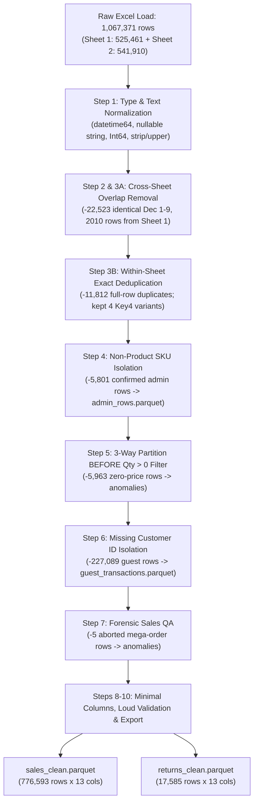

# Customer Intelligence Engine: Phase 2 Data Cleaning & Preprocessing Report

**Project**: Customer Intelligence Engine (RFM Segmentation + 90-Day CLV Regression)  
**Source Notebook**: [`2_data_cleaning_&_data_preprocessing.ipynb`](../Notebooks/2_data_cleaning_&_data_preprocessing.ipynb)  
**Raw Input**: `data/raws/online_retail_II.xlsx` (`Year 2009-2010` + `Year 2010-2011`)  
**Execution Environment**: Python `3.12.10` (`.venv` with `pandas 3.1.1`, `pyarrow 26.0.1`)  
**Status**: Completed, Validated (100% Row Conservation), and Exported to Parquet  
**Next Phase**: Phase 3 — Feature Engineering, Temporal Cutoff ($T_{\text{cutoff}}$), & Modeling  

---

## Executive Summary

Phase 2 transformed the raw consolidated **1,067,371** transaction records into four strictly validated, type-safe Parquet datasets inside `data/processed/`, while preserving full auditability through an end-to-end **Row Accounting Ledger**. Rather than silently deleting anomalous or non-standard records, every row from the raw Excel workbook was deterministically routed, verified with loud data-contract assertions, and reconciled down to the exact row (`1,067,371 == 1,067,371`).

### Output Artifacts & Post-Cleaning Benchmarks

| Parquet Artifact (`data/processed/`) | Rows | Cols | Size (Disk) | Unique Customers | Unique Invoices | Monetary Total (£) | Role in Downstream Phases |
| :--- | :---: | :---: | :---: | :---: | :---: | :---: | :--- |
| **`sales_clean.parquet`** | **776,593** | `13` | `5.92 MB` | `5,852` | `36,591` | **+£16,783,959.54** | Positive merchandise orders for registered accounts |
| **`returns_clean.parquet`** | **17,585** | `13` | `0.33 MB` | `2,443` | `7,281` | **-£464,336.83** | Customer returns/cancellations to compute net CLV & return rates |
| **`guest_transactions.parquet`** | **227,089** | `14` | `1.52 MB` | `0` (`<NA>`) | `3,045` | **+£2,568,806.36** | Anonymous checkouts isolated from customer-level training |
| **`admin_rows.parquet`** | **5,801** | `14` | `0.16 MB` | `—` | `5,467` | **-£71,865.37** | Shipping, bank/marketplace fees, manual adjustments, samples, test/gift codes |

* **Combined Registered Merchandise Net Revenue (`sales_clean + returns_clean`)**: **£16,319,622.71** across **5,875 unique registered customers** (`5,852` with sales; `23` with return entries only) and **41 countries**, spanning `2009-12-01 07:45:00` to `2011-12-09 12:50:00`.
* **Audit Holdout (`anomalies`, in-memory)**: **5,968** rows (`5,963` zero-price warehouse logs/giveaways + `5` aborted same-day entry-error rows).
* **Duplicates Pruned (`removed_duplicates`)**: **34,335** rows (`22,523` identical Dec 1–9, 2010 cross-sheet overlap + `11,812` within-sheet exact duplicates).

---

## 1. Strict Scope & Pipeline Architecture

This phase **exclusively** cleans, normalizes, audits, and splits transaction-level records.

### Interview Defense: Why No RFM, Scaling, or Encoding Here?
1. **Preventing Temporal Data Leakage**: Both RFM segmentation and 90-day CLV regression require choosing a temporal cutoff date ($T_{\text{cutoff}}$) separating historical feature windows from the 90-day future target window. Computing customer aggregates across all 24 months prior to splitting leaks future behavior into historical features.
2. **Preventing Preprocessing Leakage**: Feature scalers (`RobustScaler`, `StandardScaler`), logarithmic transforms, and categorical encoders must be fit **strictly on the training fold** after temporal splitting.
3. **Minimal Allowed Derived Columns**: Only deterministic transaction-level attributes (`source_sheet`, `is_cancellation`, `TotalPrice`, `invoice_date`, `year_month`) were added.

---

## 2. Step-by-Step Findings & Engineering Decisions

### Step 0 & Step 1: Multi-Sheet Loading & Type/Text Normalization
* **Sheet Provenance (`source_sheet`)**: Tagged each sheet before concatenating with `ignore_index=True` so cross-sheet duplicates could be audited in Step 2 without losing origin metadata or creating duplicate row indices.
* **Mixed-Type & Whitespace Discovery**:
  * Excel stored pure-digit identifiers as Python `int` and alphanumeric codes as `str` inside `object` columns (`Invoice`: `1,047,871` ints + `19,500` strings; `StockCode`: `932,385` ints + `134,986` strings; `Description`: `4` raw integers representing SKU numbers).
  * Text checks uncovered **213,035** `Description` whitespace anomalies, **3,471** lowercase `StockCode` variations, **1** `StockCode` with trailing space (`'47503J '`), and **0** fractional `Customer ID`s.
* **Engineering Remedy**: Cast text columns using pandas nullable `"string"` (instead of `.astype(str)`) to preserve all `4,382` genuine `<NA>` descriptions rather than turning them into the string `"nan"` and without dropping the 4 integer descriptions during `.str.strip()`. Cast `Customer ID` to nullable `Int64` to remove `.0` floats while preserving `243,007` missing IDs as `<NA>`. Flagged `is_cancellation = Invoice.str.startswith("C")` (`19,494` rows).

---

### Step 2 & Step 3: Cross-Sheet Overlap vs. Within-Sheet Deduplication
* **Cross-Sheet Overlap Audit (`Step 2 -> 3A`)**:
  * Sheet 1 (`Year 2009-2010`) covers `2009-12-01` to `2010-12-09`; Sheet 2 (`Year 2010-2011`) covers `2010-12-01` to `2011-12-09`.
  * Using a **multiset comparison** (`groupby(compare_cols).size()`), all **22,523 rows** inside `2010-12-01 08:26` to `2010-12-09 20:01` were proven **100% identical** between both sheets (`0` differing row keys), including `321` within-sheet repeat lines inside those 9 days on each sheet.
  * Dropped Sheet 1's copy (`-22,523` rows), keeping Sheet 2 (`1,067,371 -> 1,044,848`).
* **Within-Sheet Exact Duplicates (`Step 3B`)**:
  * Audited **`11,812`** exact full-row duplicates (`1.13%` of rows across `4,387` invoices, worth **`£54,228.42`** or **`0.29%`** of net revenue) plus **`4` pairs (`8` rows)** matching `(Invoice, StockCode, Quantity, Price)` that differed by a 1-minute timestamp rollover (`492807`, `567183`) or updated description wording (`554084`, `575335`).
  * **Forensic Pattern**: `85.7%` (`10,127`) of exact duplicates occurred non-consecutively within an invoice (`70.5%` = `8,331` with `Quantity == 1`), suggesting unmerged web-cart additions, while `14.3%` (`1,685`) occurred immediately consecutively (`idx_gap == 1`), typical of double-scans.
  * **Decision**: Dropped the `11,812` exact full-row duplicates (`keep="first"`, keeping the 4 differing Key4 pairs) to satisfy strict transaction uniqueness (`1,044,848 -> 1,033,036`), and documented the `0.29%` revenue trade-off as a known limitation.

---

### Step 4: Data-Driven Non-Product SKU Isolation (`admin_rows`)
Rather than copying a hardcoded list from online blogs, we inspected **all 61 StockCodes** (`5,980` rows) failing the standard 5-digit catalog pattern `^\d{5}[A-Z]*$`:

| Category | Unique Codes | Total Rows | Total Revenue (£) | Action Taken |
| :--- | :---: | :---: | :---: | :--- |
| **`postage`** (`POST`, `DOT`, `C2`) | `3` | `3,788` | `+£433,410.51` | Moved to `admin_rows` |
| **`manual_adjustments`** (`M`, `D`, `ADJUST`, `ADJUST2`, `B`) | `5` | `1,641` | `-£236,238.70` | Moved to `admin_rows` |
| **`bank_charges`** (`BANK CHARGES`, `AMAZONFEE`, `CRUK`) | `3` | `152` | `-£264,936.18` | Moved to `admin_rows` |
| **`gift_vouchers`** (`GIFT_0001_10..90`, `GIFT`) | `10` | `101` | `+£1,686.61` | Moved to `admin_rows` |
| **`samples`** (`S`) | `1` | `101` | `-£5,991.11` | Moved to `admin_rows` |
| **`test_codes`** (`TEST001`, `TEST002`) | `2` | `17` | `+£203.50` | Moved to `admin_rows` |
| **`other (unknown <NA> adjustment)`** (`C3`) | `1` | `1` | `£0.00` | Moved to `admin_rows` |
| **`other (legacy SKU / add-on product)`** (`DCGS*`, `PADS`, `SP1002`) | `36` | `179` | `+£1,132.89` | **Retained** as real physical merchandise |

* **Key Nuance**: Separating `5,801` confirmed non-product/admin rows (`25` codes) into `admin_rows.parquet` prevented shipping fees (`+£433k`) and marketplace/bad-debt write-offs (`-£501k`) from distorting product demand or CLV, while keeping `179` real physical merchandise rows (`DCGS*` all guest `<NA>`, `SP1002`, `PADS`).

---

### Step 5: Order-Sensitive 3-Way Partition (`sales`, `returns`, `anomalies`)
Splitting **before** filtering `Quantity > 0` partitioned the `1,027,235` remaining rows with zero overlap:
* **`sales`** (`~is_cancellation & Quantity > 0 & Price > 0`): **`1,003,357`** rows (`97.68%`).
* **`returns`** (`is_cancellation & Quantity < 0 & Price > 0`): **`17,915`** rows (`1.74%`).
* **`anomalies`** (everything else): **`5,963`** rows (`0.58%`) — **100%** were `Price == 0.0` (`2,572` positive qty giveaways/found stock, `3,391` negative qty damages/lost/missing/`<NA>`, with `61` rows having a registered `Customer ID`). Observed **0** rows with `Price < 0`, **0** non-C rows with `Quantity < 0 & Price > 0`, and **0** C-invoices with `Quantity > 0`.

---

### Step 6: Missing `Customer ID` Isolation & Guest Seasonality Drift
* Moved **`227,089`** guest rows (`226,761` sales = `22.60%` of sales rows; `328` returns = `1.83%` of return rows) into `guest_transactions.parquet` instead of imputing a fake `0` ID (which would merge 227k anonymous orders into one synthetic super-customer).
* **Row vs. Revenue Share**: Guests account for **`22.24%`** of `sales + returns` rows but only **`13.11%`** of gross sales revenue (`£2,575,278.90` / `£19,643,861.64`), confirming smaller average basket values than registered B2B/repeat buyers.
* **Non-Stationary Guest Share Over Time**: Monthly monitoring proved that guest checkout row share is **strongly seasonal**, spiking during **December–January** holiday/clearance windows (`2009-12`: `30.27%`, `2010-12`: **`37.37%` of rows / `27.13%` of revenue**, `2011-01`: **`38.36%` of rows**, `2011-12`: `31.47%`) versus `14.3%–24.5%` during Feb–Oct.

---

### Step 7: Quality Audit on `sales` & Mega-Order Forensics
* **Top 20 `Quantity` & `TotalPrice` Investigation**: Cross-matching `Customer ID`, `StockCode`, `Quantity`, **`Price`**, and `admin_rows` reversals revealed two distinct patterns:
  1. **3 Same-Day Aborted Entry Errors (`5` Product Rows Moved to `anomalies`)**:
     * `581483` (Cust `16446`, `80,995 @ £2.08 = £168,469.60`) $\leftrightarrow$ canceled `+12 min` later by `C581484`.
     * `541431` (Cust `12346`, `74,215 @ £1.04 = £77,183.60`) $\leftrightarrow$ canceled `+16 min` later by `C541433`.
     * `556444` (Cust `15098`, `60 @ £649.50 = £38,970.00`) $\leftrightarrow$ reversed `+3 min` later via **Manual `'M'` credit `C556445`** (already in `admin_rows`), whereas `C556448` (`-60 @ £4.95`) actually balanced Customer `15098`'s earlier order `556442` (`+60 @ £4.95`). Checking `Price` prevented mispairing `556444` with `C556448`!
  2. **Legitimate Wholesale & Re-Invoicing**: Multi-day B2B re-invoicing (`540815/C550456` +97d re-ordered on `550461`) and uncanceled repeat wholesale buyers (`13902` Denmark, `17940` UK, `17450`, `14646`, `12931`) were kept intact (`new max TotalPrice = £15,818.40`).
* **Nulls, Odd Countries & Time Gaps**:
  * Remaining `Description` nulls in `sales`: **`0`**.
  * Retained valid registered transactions labeled `Unspecified` (`518` rows, `16` invoices, `6` customers) and `European Community` (`57` rows, `3` invoices, `1` customer `15108`).
  * Weekly invoice checks (`106` weeks, median `315.5`, max `667`) showed only two `0`-invoice weeks (`2010-01-03` and `2011-01-02`), aligning identically with the two **12-day Christmas/New Year store closures** (`2009-12-23 -> 2010-01-04` and `2010-12-23 -> 2011-01-04`) and 5-day Easter holidays — confirming **zero ETL dropouts**.

---

## 3. Complete Row Accounting Ledger (`1,067,371` Raw Rows Reconciled)

| Step | Rows Before | Rows After | Removed / Moved | Reason |
| :--- | :---: | :---: | :---: | :--- |
| Step 0: Load & Concat | 1,067,371 | 1,067,371 | 0 | Loaded Year 2009-2010 (`525,461`) + Year 2010-2011 (`541,910`) with `source_sheet` tag |
| Step 1: Type & Text Normalization | 1,067,371 | 1,067,371 | 0 | Cast dtypes (`datetime64`, `string`, `Int64`), stripped text, uppercased `StockCode`, added `is_cancellation` |
| Step 2: Sheet Overlap Audit | 1,067,371 | 1,067,371 | 0 | Audited overlap (`2010-12-01` to `2010-12-09`): `22,523` rows per sheet, `0` diffs |
| Step 3A: Remove Cross-Sheet Overlap | 1,067,371 | 1,044,848 | 22,523 | Dropped `Year 2009-2010` copy of identical Dec 1–9, 2010 overlap (kept `Year 2010-2011`) |
| Step 3B: Remove Within-Sheet Duplicates | 1,044,848 | 1,033,036 | 11,812 | Dropped exact full-row duplicates (`keep='first'`); kept 4 pairs differing in timestamp/description |
| Step 4B: Move Non-Product Rows to `admin_rows` | 1,033,036 | 1,027,235 | 5,801 | Moved `5,801` confirmed admin/non-product rows (`25` codes) to `admin_rows`; kept `179` legacy product rows |
| Step 5: Split Sales / Returns / Anomalies | 1,027,235 | 1,021,272 | 5,963 | Partitioned into `sales` (`1,003,357`) + `returns` (`17,915`); moved `5,963` anomalies out |
| Step 6: Isolate Missing Customer ID | 1,021,272 | 794,183 | 227,089 | Moved `227,089` guest rows (`226,761` sales + `328` returns) to `guest_transactions` |
| Step 7: Quality Checks on `sales` | 794,183 | 794,183 | 0 | Audited top-20 outliers, `0` null descriptions, odd countries, and `106` weekly invoice counts |
| Step 7B: Isolate Aborted Mega-Order Errors | 794,183 | 794,178 | 5 | Moved 3 same-day (3–16 min) aborted entry errors + 2 product return counterparts (`5` rows) to `anomalies` |
| Step 8: Add Minimal Transaction Columns | 794,178 | 794,178 | 0 | Added `TotalPrice`, `invoice_date`, and `year_month` to all partitioned tables |
| Step 9: Validation Assertions | 794,178 | 794,178 | 0 | All 6 groups of loud data-contract & reconciliation assertions PASSED |
| Step 10: Export Parquet Artifacts | 794,178 | 794,178 | 0 | Exported `sales_clean`, `returns_clean`, `guest_transactions`, `admin_rows` to `data/processed/*.parquet` |

**Verification**: `776,593 (sales) + 17,585 (returns) + 227,089 (guest) + 5,968 (anomalies) + 5,801 (admin) + 34,335 (removed duplicates) == 1,067,371` (`100.00%` reconciled).

---

## 4. Known Limitations & Directives for Phase 3 (Feature Engineering & Modeling)

1. **Always Net Returns Against Sales**: Downstream RFM Monetary and 90-day CLV targets must join `sales_clean.parquet` with `returns_clean.parquet` (`NetSpend = Sales + Returns`) so multi-day B2B cancellations (`+28d`, `+97d`) do not inflate Monetary estimates. Note also that **23 registered accounts** exist only in `returns_clean` without matching positive orders in `sales_clean`.
2. **Enforce Temporal Cutoff ($T_{\text{cutoff}}$)**: Pick a snapshot cutoff date (e.g., `2011-09-09`, leaving `90` full days through `2011-12-09` for the CLV target window) before computing Recency, Frequency, Monetary, Tenure, or Return Rate.
3. **Holiday Closure Awareness**: When computing inter-purchase times or Recency, remember the store shuts down for ~12 days every late December–early January and ~5 days at Easter.
4. **Registered-Customer Scope & Seasonality Bias**: Customer models exclude `guest_transactions` (`13.11%` of gross sales revenue, surging to `27.13%` of revenue in Dec 2010). Include seasonal/Q4 indicators for registered buyers so Q4-only shoppers are not misclassified.
5. **Within-Sheet Duplicates Trade-Off**: Dropping `11,812` exact full-row duplicates enforces uniqueness at a maximum cost of `0.29%` of revenue (`£54.2k`), noting that ~85.7% were non-consecutive `Qty=1` re-entries.
6. **Country Handling**: Treat `'Unspecified'` (`518` rows) explicitly during country feature encoding rather than imputing `'United Kingdom'`.

