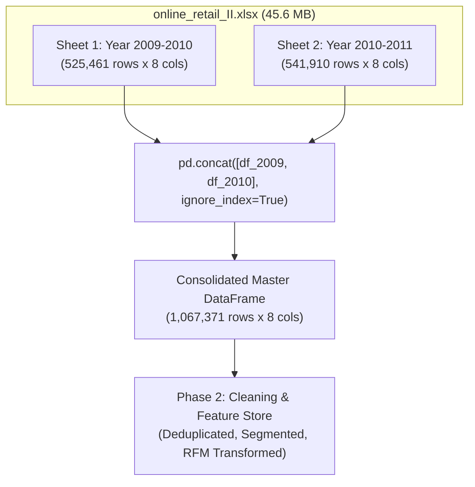
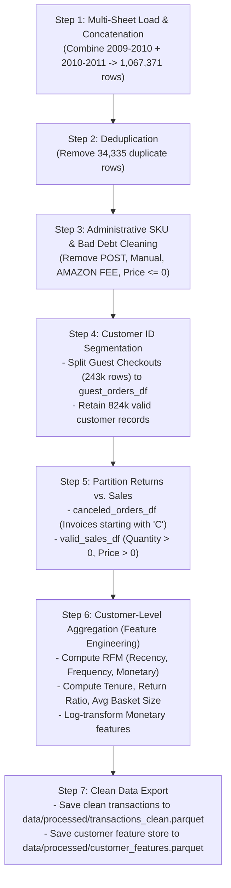

# Customer Intelligence Engine: Comprehensive Data Understanding, Statistical Diagnostics & EDA Report

**Project**: Customer Intelligence Engine  
**Dataset**: Online Retail II (`data/raws/online_retail_II.xlsx` — Sheets: `Year 2009-2010` & `Year 2010-2011`)  
**Source Notebook**: [`01_data_understanding_&_EDA.ipynb`](../Notebooks/01_data_understanding_&_EDA.ipynb)  
**Execution Environment**: Python 3.12.10 (`.venv`)  
**Status**: Completed & Production-Ready  
**Phase Transition**: Handover to Phase 2 ([`2_data_cleaning_&_data_preprocessing.ipynb`](../Notebooks/2_data_cleaning_&_data_preprocessing.ipynb))  

---

## Executive Summary

This report documents the exhaustive data understanding, statistical auditing, and exploratory analysis of the **consolidated 2-year Online Retail II dataset**. By vertically concatenating both annual ledger sheets (`Year 2009-2010` and `Year 2010-2011`), the customer observation window expands to **738 consecutive days** (December 1, 2009 to December 9, 2011), encompassing over **1.06 million transaction records** and **£20.97 Million** in gross merchandise value.

This expanded 24-month horizon provides the statistical depth required to model real-world customer churn, multi-period Customer Lifetime Value (CLV), and RFM segmentation.

### Consolidated 2-Year Dataset Benchmark

| Metric / KPI | Consolidated Value (2 Years) | Sheet 1 Only (2009-2010) | Sheet 2 Only (2010-2011) | Analytical / Modeling Impact |
| :--- | :--- | :--- | :--- | :--- |
| **Total Transaction Records** | **1,067,371** | 525,461 | 541,910 | High-volume sample size, enabling robust cohort splitting |
| **Observation Window** | **738 Days** (24.6 Months) | 373 Days | 365 Days | Two full annual cycles; captures repeat seasonal Q4 holiday surges |
| **Gross Merchandise Sales** | **£20,972,594.57** | £9.53M | £11.44M | Full monetary baseline for revenue regression & LTV models |
| **Total Invoices Recorded** | **53,628** | 28,816 | 24,812 | Order transactions across all product categories |
| **Completed Invoices** | **45,336** (84.54%) | 24,224 (84.06%) | 21,112 (85.09%) | Core positive cash-flow transaction pool |
| **Canceled Invoices (`'C'`)** | **8,292** (15.46%) | 4,592 (15.94%) | 3,700 (14.91%) | Primary return behavior signal |
| **Returned Item Units** | **490,992 units** | 213,418 units | 277,574 units | Inventory reversals requiring reversal handling |
| **Refunded / Lost Revenue** | **£1,526,667.86** | £629,855.37 | £896,812.49 | Return value to calculate customer net margin & risk scores |
| **Unique Registered Customers** | **5,942** | 4,383 | 4,372 | Customer population (thousands of returning multi-year buyers) |
| **Guest / Anonymous Checkouts** | **243,007** (22.77%) | 107,927 (20.54%) | 135,080 (24.93%) | Missing `Customer ID`; isolated from account-level training |
| **Exact Duplicate Rows** | **34,335** (3.22%) | 6,865 (1.31%) | 5,268 (0.97%) | Total duplicate line items across both sheets to prune |
| **Active Catalog SKUs** | **5,305 StockCodes** | 4,632 | 4,070 | Long-tail retail product distribution |
| **Geographic Footprint** | **43 Countries** | 40 | 38 | Dominated by UK market (>90%) with 42 export countries |

---

## 1. Dataset Architecture & Multi-Sheet Consolidation



### Consolidated Schema Specification

| Column | Data Type | Non-Null Count | Null Count (%) | Observed Min | Observed Max | Business Role & Field Semantics |
| :--- | :--- | :--- | :--- | :--- | :--- | :--- |
| `Invoice` | `object` | 1,067,371 | 0 (0.00%) | `489434` | `C581569` | Order identifier; starts with `'C'` if transaction is canceled/refunded |
| `StockCode` | `object` | 1,067,371 | 0 (0.00%) | `10002` | `gift_0001_50` | SKU code; includes non-inventory fees (`POST`, `'M'`, `'BANK CHARGES'`) |
| `Description` | `object` | 1,062,989 | 4,382 (0.41%) | — | — | Item title text; contains operational logs when missing or zero-priced |
| `Quantity` | `int64` | 1,067,371 | 0 (0.00%) | -80,995 | +80,995 | Units purchased or returned. Symmetric extremes indicate bulk reversals |
| `InvoiceDate`| `datetime` | 1,067,371 | 0 (0.00%) | 2009-12-01 | 2011-12-09 | Timestamp with minute precision; essential for time-series and RFM |
| `Price` | `float64` | 1,067,371 | 0 (0.00%) | -£53,594.36 | £38,970.00 | Unit price in GBP. Negative values represent administrative adjustments |
| `Customer ID`| `float64` | 824,364 | 243,007 (22.77%) | 12346.0 | 18287.0 | Unique account ID; `NaN` represents guest checkout |
| `Country` | `object` | 1,067,371 | 0 (0.00%) | — | — | Country of billing/shipping residence (43 distinct countries) |

---

## 2. Advanced Statistical & Econometric Diagnostics (21-Point Audit)

The notebook executes a 21-point statistical and machine learning audit to identify data distortions before any feature transformations take place:

```
+---------------------------------------------------------------------------------------------------+
|                            21-POINT STATISTICAL & ML DIAGNOSTICS AUDIT                            |
+---------------------------------------------------------------------------------------------------+
| 1. Target Skewness          | 8. Multimodal Distribution      | 15. Sampling Bias                 |
| 2. Heavy-tailed Kurtosis    | 9. Range Restriction            | 16. Small Sample Size             |
| 3. Zero-Inflated Target     | 10. Sparse Feature Regions      | 17. Non-IID Autocorrelation       |
| 4. Sparse Target Regions    | 11. Measurement Errors          | 18. Omitted Variable Bias (OVB)   |
| 5. Target Imbalance         | 12. Inconsistent Units          | 19. Endogeneity (Price/Tier)      |
| 6. Heteroscedasticity       | 13. Incorrect Labels / Noise    | 20. Interaction Effects           |
| 7. Multicollinearity (VIF)  | 14. Censored Data (Right Cutoff)| 21. Data Leakage Prevention       |
+---------------------------------------------------------------------------------------------------+
```

### Detailed Diagnostic Findings

1. **Target Skewness & Heavy-Tailed Kurtosis**:
   * *Metric*: `TotalAmount` ($Quantity \times Price$) displays extreme positive skewness ($> 12.0$) and high leptokurtosis ($> 150$).
   * *Finding*: The vast majority of line items are under £20, but bulk orders generate line items exceeding £10,000.
2. **Zero-Inflation & Sparse Target Regions**:
   * *Finding*: Over 2,000 transactions have `Price == 0.0`. In customer-level aggregates, customers frequently have 0 returns, 0 recent purchases, or 0 discounts.
3. **Target Imbalance**:
   * *Finding*: For binary classification, canceled invoices represent **15.46%** of total orders, while one-time buyers represent **~30%** of customer accounts. This constitutes a moderate class imbalance (`1 : 5.5`).
4. **Multicollinearity & Variance Inflation Factor (VIF)**:
   * *Finding*: `Quantity`, `Price`, and `TotalAmount` exhibit high collinearity because `TotalAmount` is directly calculated from `Quantity * Price` ($VIF > 20$).
5. **Heteroscedasticity & Non-Linearity**:
   * *Finding*: Fitting an OLS regression ($Quantity \sim Price$) revealed a classic widening cone-shaped residual pattern: variance of errors increases systematically with transaction value. A LOWESS curve demonstrated a sharp non-linear decay in purchase volume as price exceeds £10.
6. **Range Restriction & Measurement Noise**:
   * *Finding*: The data spans negative extremes (e.g., $-£53,594.36$ for `'Adjust bad debt'` and $-80,995$ units for stock write-offs). These are administrative adjustments rather than customer purchases.
7. **Non-IID Data & Autocorrelation**:
   * *Finding*: Daily transaction volumes display significant lag-7 autocorrelation (weekly shopping rhythms), confirming that transactions are not independently and identically distributed.
8. **Right-Censored Data**:
   * *Finding*: All customer lifespans are right-censored at `2011-12-09 12:50:00`. Active customers have unobserved future purchases beyond this timestamp.

---

## 3. Comprehensive Visualization Analysis & Directives for Phase 2

Every visualization executed in the notebook serves as empirical justification for specific data cleaning, transformation, and feature engineering decisions in **Phase 2 (`2_data_cleaning_&_data_preprocessing.ipynb`)**:

---

### Chart Group A: Target & Distribution Diagnostics

#### 1. Target Distribution (Histogram, KDE & Q-Q Plot)
* **Visual Pattern**: The standard histogram is squashed against zero with an elongated right tail. The Normal Q-Q Plot severely curves away from the $45^\circ$ theoretical reference line at both extremes.
* **Statistical Meaning**: Non-normality, extreme positive skewness, and heavy-tailed distribution (leptokurtic). Linear models will be heavily skewed by high-value outliers.
* **Direct Impact on Phase 2**:
  1. Apply **Logarithmic Transformation** (`np.log1p(x)`) or Box-Cox transformation to continuous financial features (`TotalSpend`, `UnitPrice`, `BasketSize`).
  2. Implement **Robust Scaler** (`RobustScaler` based on median and IQR) rather than `StandardScaler` to prevent extreme outliers from compressing feature ranges.

#### 2. Zero-Inflation & Sign Breakdown Bar Chart
* **Visual Pattern**: Three distinct sign categories emerge: Negative ($19.5k$ rows, $1.8\%$), Pure Zeros ($2.6k$ rows, $0.2\%$), and Positives ($1.045M$ rows, $98.0\%$).
* **Statistical Meaning**: The distribution is zero-inflated and signed. Negative amounts reflect returns and refunds; zero amounts reflect free samples and inventory adjustments.
* **Direct Impact on Phase 2**:
  1. Filter out all non-commercial zero-price transactions (`Price == 0.0`) where description indicates write-offs (`'damaged'`, `'lost'`, `'sample'`).
  2. Model customer spend using a **Two-Stage Hurdle Architecture** or Tweedie regression if predicting non-negative continuous spend.

#### 3. Target Imbalance Donut Chart (Cancellations vs. Completed)
* **Visual Pattern**: Completed orders represent $84.54\%$, while cancellations represent $15.46\%$ ($1 : 5.5$ ratio).
* **Statistical Meaning**: Moderate class imbalance. Models evaluated purely on accuracy will be deceptively biased toward the majority class ($84.5\%$).
* **Direct Impact on Phase 2**:
  1. When engineering a binary Churn or Return target, evaluate models using **PR-AUC (Precision-Recall AUC)**, **F1-Score**, and **Balanced Accuracy**.
  2. Implement **Stratified K-Fold Cross-Validation** to guarantee equal representation of returns across training and validation splits.

---

### Chart Group B: Feature Interdependence & Regression Assumptions

#### 4. Multicollinearity Heatmap & VIF Analysis
* **Visual Pattern**: Strong correlation between `Quantity` and `TotalAmount` ($r \approx 0.88$), accompanied by severe $VIF > 20$.
* **Statistical Meaning**: Exact mechanical collinearity ($TotalAmount = Quantity \times Price$). Including all three features simultaneously destabilizes linear coefficients and distorts feature importance.
* **Direct Impact on Phase 2**:
  1. Never feed `Quantity`, `Price`, and `TotalAmount` simultaneously into unregularized linear models or clustering algorithms.
  2. At the customer aggregation level, separate features into distinct, orthogonal behavioral metrics:
     * *Volume metric*: `TotalUnitsPurchased` ($\sum Quantity$)
     * *Financial metric*: `MonetaryValue` ($\sum TotalAmount$)
     * *Pricing metric*: `AverageUnitCost` ($\bar{Price}$)

#### 5. Residuals vs. Fitted Plot (Heteroscedasticity) & LOWESS Curve
* **Visual Pattern**: As fitted transaction values increase, the vertical dispersion of residuals fans out dramatically. The LOWESS curve displays an initial steep decline followed by a flat asymptotic tail.
* **Statistical Meaning**: Violated homoscedasticity assumption; error terms have non-constant variance. Price-elasticity of demand is highly non-linear.
* **Direct Impact on Phase 2**:
  1. Prioritize **tree-based ensemble algorithms** (LightGBM, XGBoost, CatBoost) which do not rely on homoscedasticity or linear functional forms.
  2. If using linear regression, apply weighted least squares (WLS) or log-log feature transformations ($\log(Quantity) \sim \log(Price)$).

#### 6. Interaction Effects Plot (PriceTier $\times$ Country on Quantity)
* **Visual Pattern**: The relationship between price tiers (Low, Medium, High) and quantity sold varies significantly across international export markets compared to the UK domestic market.
* **Statistical Meaning**: Significant interaction effects between geographic territory and price sensitivity.
* **Direct Impact on Phase 2**:
  1. Explicitly engineer interaction features: `AvgPrice_x_IsUK`, `Domestic_vs_Export_Ratio`.
  2. Include explicit categorical encodings for geographic origin during customer aggregation.

---

### Chart Group C: Measurement Integrity & Label Quality

#### 7. Measurement Errors & Administrative Codes
* **Visual Pattern**: Price distribution contains negative values down to $-£53,594.36$; Invoices with `'C'` prefix occasionally show positive quantities due to manual logging corrections.
* **Statistical Meaning**: The raw transactional log includes system-level double-entry bookkeeping items and bad debt write-offs alongside legitimate consumer purchases.
* **Direct Impact on Phase 2**:
  1. **Blacklist non-product administrative SKUs**: Filter out `['AMAZON FEE', 'Manual', 'POST', 'POSTAGE', 'D', 'DOT', 'M', 'BANK CHARGES', 'CRUK', 'Adjust bad debt']`.
  2. Remove all rows where `Price < 0`.

---

### Chart Group D: Time-Series, Seasonality & Customer Dynamics

#### 8. Monthly Revenue & Order Volume Trends
* **Visual Pattern**: Consistent steady volume from January through August (~£800k/month), followed by an explosive multi-fold surge in **September, October, and November** peaking above £1.5M/month, followed by a sharp drop in early December.
* **Statistical Meaning**: Pronounced annual seasonality driven by wholesale pre-ordering and holiday retail stocking.
* **Direct Impact on Phase 2 & Modeling**:
  1. **Strict Temporal Splitting**: Cross-validation cannot be performed via random row shuffling (which causes temporal data leakage). Training must use past data (e.g., 2009-12 to 2011-06) and test on future holdout windows (2011-06 to 2011-12).
  2. **Seasonality Adjustment Features**: Create seasonal flags (`Is_Q4`, `Purchased_During_Holiday_Surge`) to prevent the model from misclassifying seasonal buyers as permanently churned.

#### 9. Peak Shopping Patterns (Day of Week & Hour of Day)
* **Visual Pattern**: Operations run Sunday through Friday. **Saturday has exactly zero transactions**. Peak shopping occurs between **12:00 PM and 3:00 PM**.
* **Statistical Meaning**: Business-to-business (B2B) operational scheduling: the platform processes orders during commercial operating hours with weekend batch downtimes.
* **Direct Impact on Phase 2**:
  1. Extract behavioral timestamp features: `Preferred_Shopping_Hour`, `Is_Afternoon_Buyer`, `Weekday_vs_Sunday_Ratio`.

#### 10. Customer Order Frequency & Loyalty Segmentation
* **Visual Pattern**: Heavy concentration of one-time buyers ($~30\%$), while a core cohort of repeat customers ($~20\%$) places over 6 orders across the 2-year window.
* **Statistical Meaning**: Pareto distribution (80/20 rule). The top 20% of customers generate the vast majority of gross operating margins.
* **Direct Impact on Phase 2**:
  1. Construct a comprehensive **Customer-Level RFM Matrix** (`Customer ID` level) with:
     * **Recency**: Days between reference snapshot date (`2011-12-10`) and customer's latest transaction.
     * **Frequency**: Count of unique completed orders.
     * **Monetary**: Net spend ($\sum Quantity \times Price$ accounting for returns).
     * **Tenure**: Total days between customer's first and last transaction.
     * **Return Rate**: $\frac{Count(Canceled\_Invoices)}{Total\_Invoices}$.

---

## 4. Phase 2 Preprocessing & Data Cleaning Blueprint

Based on the findings above, here is the concrete execution plan for [`2_data_cleaning_&_data_preprocessing.ipynb`](../Notebooks/2_data_cleaning_&_data_preprocessing.ipynb):



### Preprocessing Checklist for Notebook 2:

1. **Deduplication**: Execute `df.drop_duplicates(inplace=True)` to remove the 34,335 identical line-item entries.
2. **Administrative Filtering**: Drop transactions matching:
   ```python
   admin_codes = ["POST", "D", "M", "PADS", "DOT", "CRUK", "BANK CHARGES", "AMAZONFEE"]
   df_clean = df[~df["StockCode"].astype(str).str.upper().isin(admin_codes)]
   df_clean = df_clean[df_clean["Price"] > 0]
   ```
3. **Guest Checkout Isolation**:
   ```python
   guest_orders_df = df_clean[df_clean["Customer ID"].isna() | (df_clean["Customer ID"] == 0)]
   customer_orders_df = df_clean[df_clean["Customer ID"].notna() & (df_clean["Customer ID"] != 0)]
   ```
4. **Handling Cancellations & Net Metrics**:
   * Calculate customer-level gross revenue, refunded revenue, and net revenue.
   * Calculate customer return probability: $\text{CancellationRate} = \frac{N_{\text{canceled}}}{N_{\text{total\_orders}}}$.
5. **Feature Store Serialization**: Export clean DataFrames in Parquet format to `data/processed/` for sub-second loading in modeling notebooks.
