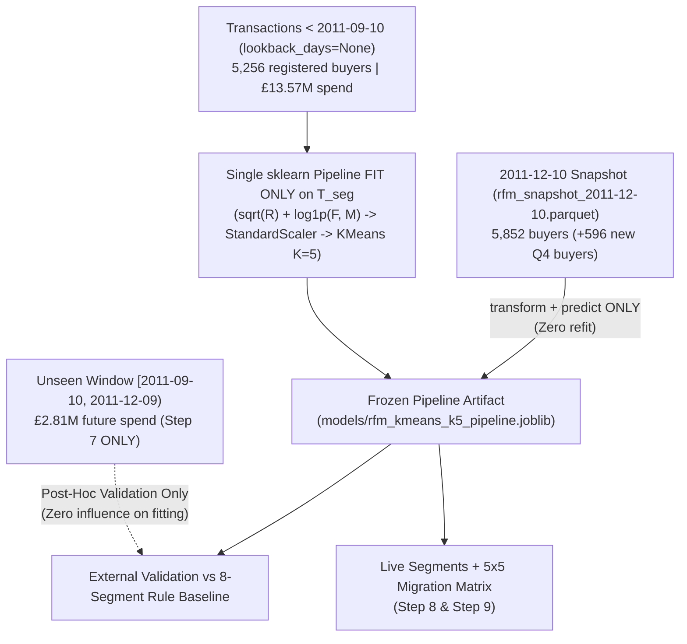

# Customer Intelligence Engine: Phase 4a Unsupervised RFM Segmentation Report

**Project**: Customer Intelligence Engine (RFM Segmentation + 90-Day CLV Regression)  
**Source Notebook**: [`4_rfm_segmentation.ipynb`](file:///c:/Users/mosa/Desktop/Projects/Customer-Intelligence-Engine/Notebooks/4_rfm_segmentation.ipynb)  
**Production Module**: [`src/segmentation.py`](file:///c:/Users/mosa/Desktop/Projects/Customer-Intelligence-Engine/src/segmentation.py) | **Unit Tests**: [`tests/test_segmentation.py`](file:///c:/Users/mosa/Desktop/Projects/Customer-Intelligence-Engine/tests/test_segmentation.py)  
**Inputs**: `data/processed/sales_clean.parquet`, `returns_clean.parquet`, `data/processed/features/rfm_snapshot_2011-12-10.parquet`  
**Execution Environment**: Python `3.12.10` (`.venv` with `scikit-learn 1.9.1`, `scipy 1.18.1`, `joblib 1.6.0`, `pandas 3.1.1`, `pytest 9.2.0`)  
**Status**: Completed, Externally Validated (Zero Leakage), Unit-Tested (`38/38` Passed), and Exported  
**Next Phase**: Phase 4b — Supervised 90-Day CLV Regression (`sklearn` Pipelines / Tweedie / Hurdle Modeling)

---

## Executive Summary

Phase 4a designed, audited, and deployed a **single leak-free `sklearn` `Pipeline`** for customer RFM segmentation (`sqrt(recency_days)` + `log1p(frequency, monetary)` $\rightarrow$ `StandardScaler` $\rightarrow$ `KMeans(n_clusters=5, n_init=20)`). To evaluate unsupervised segments objectively without target leakage, the pipeline was fit strictly on a historical snapshot at **`T_seg = 2011-09-10`** (`5,256` buyers), validated post-hoc against **£2.81M of unseen future spend** in `[2011-09-10, 2011-12-09)`, and then applied **without refitting** to the live **`2011-12-10`** deployment snapshot (`5,852` buyers, `£16.78M` cumulative revenue).

### Exported Production & Analytical Artifacts

| Artifact | Location | Format | Shape / Contents | Size (Disk) | Role |
|---|---|---|---|---:|---|
| **`rfm_kmeans_k5_pipeline.joblib`** | `models/` | `sklearn` Pipeline (`joblib`) | `5` clusters (3D RFM) | `23,433 B` (`0.0223 MB`) | Frozen batch inference pipeline (`predict`-ready) |
| **`segments_t_seg_2011-09-10.parquet`** | `data/processed/segmentation/` | Parquet | `5,256 x 14` | `205,835 B` (`0.1963 MB`) | Fit cohort segments + 90d external target ground truth |
| **`segments_deploy_2011-12-10.parquet`** | `data/processed/segmentation/` | Parquet | `5,852 x 13` | `297,196 B` (`0.2834 MB`) | Live CRM segment assignments + 2D PCA display coords |
| **`segment_profiles.parquet`** | `data/processed/segmentation/` | Parquet | `5 x 17` | `14,232 B` (`0.0136 MB`) | Machine-readable segment stats & CRM action table |
| **`segment_profiles.csv`** | `data/processed/segmentation/` | CSV | `5 x 17` | `1,530 B` (`0.0015 MB`) | Stakeholder-ready CRM segment summary sheet |

* **Pareto Value Concentration (`2011-12-10` Live View)**: Just **`10.87%` (`636`) `VIP Champions`** drive **`62.33%` (`£10.46M`)** of revenue; paired with **`Loyal Regulars` (`25.55%`)**, **`36.42%` of customers account for `85.17%` (`£14.29M`) of historical sales**.
* **Proven Superiority Over Rule-Based RFM**: With **3 fewer segments (`5` vs `8`)**, K-Means achieves higher non-parametric future spend separation (Kruskal-Wallis **`H = 1,636.14`** vs `1,538.33`; rank **$\eta^2 = 0.3108$** vs `0.2918`; ANOVA $\eta^2$ on `log1p(target)` = **`0.2894`** vs `0.2769`), **`74.57 pp`** reactivation spread (`90.21%` to `15.64%`), and **2x higher mean spend** per top-tier buyer (`£3,241` vs `£1,640`).
* **Software Engineering Quality**: All reusable logic lives inside [`src/segmentation.py`](file:///c:/Users/mosa/Desktop/Projects/Customer-Intelligence-Engine/src/segmentation.py) and passed **`38 / 38` unit tests** (`pytest -v` in `3.49s`), with `.gitignore` verified for all generated `.joblib`, `.parquet`, and `.csv` artifacts.

---

## 1. Architecture & Temporal Non-Leakage Design (Step 0)

### Snapshot Verification
| Snapshot | Cutoff (`exclusive`) | Max Transaction Timestamp Used | Rows | Excluded Returns-Only | Role |
|---|---|---|---:|---:|---|
| **`rfm_seg_df`** | `2011-09-10 00:00:00` | `2011-09-09 15:53` (sales) / `16:36` (returns) | `5,256` | `24` | Fit clustering pipeline + post-hoc validation |
| **`rfm_deploy_df`** | `2011-12-10 00:00:00` | `2011-12-09 12:50` (sales) / `11:58` (returns) | `5,852` | `23` *(no sales)* | Unrefitted production scoring (`+596` new Q4 buyers) |

---

## 2. Distributional Diagnostics & Preprocessing Choice (Steps 1 & 3)

### Why Untransformed K-Means Fails & How `sqrt(R) + log1p(F, M)` Fixes It
| Feature (`T_seg`, $N=5,256$) | Median | Mean | Q99 | Max | Skew (`Raw`) | Skew (`sqrt`) | Skew (`log1p`) | Chosen Transform |
|---|---:|---:|---:|---:|---:|---:|---:|:---|
| **`recency_days`** | `163.34` | `206.38` | `638.51` | `647.55` | `0.671` | **`0.008`** | `-1.021` | **`sqrt`** *(avoids left over-skew)* |
| **`frequency`** | `3.00` | `5.71` | `42.00` | `284.00` | `10.487` | `2.961` | **`1.058`** | **`log1p`** *(compresses repeat tail)* |
| **`monetary` (£)** | `776.15` | `2,582.70` | `24,372.91` | `456,780.49` | `24.263` | `5.832` | **`0.271`** | **`log1p`** *(eliminates whale explosion)* |

* **Monetary Whale Concentration**: The top **1%** (`53` wholesale buyers $\ge$ £24,372.91, led by `18102` £456.8k, `14646` £425.3k, `14156` £284.7k, `14911` £212.2k) drive **`30.74%`** of pre-`T_seg` sales; the top 10 alone contribute **`16.04%`**.
* **Whale Strategy Proof (`Keep Uncapped` vs. `Cap` vs. `Isolate`)**:

| Strategy Tested | Rows | `max \|z\|` | `% rows \|z\| > 3` | K=5 Min Cluster % | K=5 Silhouette | Decision |
|---|---:|---:|---:|---:|---:|:---|
| *Baseline*: Raw R, F, M + `StandardScaler` | 5,256 | **37.73** | 1.27% | **0.08%** *(~4 whales)* | 0.5472 *(degenerate)* | Rejected (singleton outlier clusters) |
| **`A1`: Keep all \| `sqrt(R) + log1p(F, M)` + Scaler** | 5,256 | 5.31 | 1.24% | **9.13%** | **0.3421** | **SELECTED** *(stateless single Pipeline)* |
| `A2`: Keep all \| `log1p(R, F, M)` + Scaler | 5,256 | 5.31 | 2.13% | 10.27% | 0.3360 | Rejected (`recency` over-skewed `-1.021`) |
| `B1`: Cap F & M at `q99` \| `sqrt(R) + log1p(F, M)` | 5,256 | 4.33 | 0.25% | 10.08% | 0.3419 | Unnecessary complexity (`0.0002` sil diff) |
| `C`: Isolate Top 1% monetary (cluster 99%) | 5,203 | 4.43 | 0.73% | 14.51% | 0.3360 | Breaks unified single-Pipeline contract |

Implemented via [`transform_rfm_features`](file:///c:/Users/mosa/Desktop/Projects/Customer-Intelligence-Engine/src/segmentation.py#L15-L52) and [`build_rfm_pipeline`](file:///c:/Users/mosa/Desktop/Projects/Customer-Intelligence-Engine/src/segmentation.py#L76-L99) so `joblib` serializes the entire pipeline cleanly without notebook lambdas.

---

## 3. Baseline Rule-Based RFM Scoring (Step 2)

Because **`29.97%` (`1,575 / 5,256`)** of accounts have **`frequency == 1`**, standard `pd.qcut(frequency, 5)` crashes on non-unique bin edges, and `rank(method="first")` arbitrarily splits identical `frequency == 1` accounts across `F=1` and `F=2`. Our [`score_rfm_rules`](file:///c:/Users/mosa/Desktop/Projects/Customer-Intelligence-Engine/src/segmentation.py#L144-L173) uses **average percentile ranking** (`rank(method="average", pct=True)`) binned into quintiles, assigning **100% of `freq=1` (`1,575`) to `F=1`**, `freq=2` (`891`) to `F=2`, `freq=3` (`575`) to `F=3`, `4–7` (`1,170`) to `F=4`, and `8–284` (`1,045`) to `F=5`, partitioning all `125` cells into **8 mutually exclusive segments**.

---

## 4. Selecting `K = 5` & Structural Robustness Checks (Steps 4 & 5)

### 4.1 Multi-Metric $K$-Selection Sweep (`K = 2..10`)
Evaluating [`evaluate_kmeans_k_range`](file:///c:/Users/mosa/Desktop/Projects/Customer-Intelligence-Engine/src/segmentation.py#L176-L242) with 20 bootstrap resamples confirmed why Elbow alone is inadequate on smooth customer clouds and why **`K = 5`** is the optimal operating point:

| `K` | Inertia | Silhouette ↑ | Davies-Bouldin ↓ | Calinski-Harabasz ↑ | Bootstrap Stability (Mean ARI ± Std) ↑ | Min Cluster % | `< 3%` Flag |
|---:|---:|---:|---:|---:|---:|---:|:---:|
| `2` | 7,589.8 | 0.4402 | 0.8507 | 5,661.4 | `0.9813 ± 0.0134` | 39.23% | `False` |
| `3` | 5,476.8 | 0.3529 | 1.0096 | 4,935.3 | `0.9498 ± 0.0274` | 21.84% | `False` |
| `4` | 4,332.5 | **0.3609** | 0.9605 | 4,621.0 | `0.8939 ± 0.0730` | 21.88% | `False` |
| **`5`** | 3,508.4 | 0.3421 | **0.9148** | 4,587.2 | **`0.9515 ± 0.0214`** | 9.13% | `False` |
| `6` | 3,124.0 | 0.3200 | 0.9757 | 4,249.7 | `0.8857 ± 0.1066` | 6.22% | `False` |
| `10` | 2,204.7 | 0.2773 | 1.0132 | 3,586.0 | `0.6066 ± 0.1320` | 3.81% | `False` |

* **Why `K = 5`?** Lowest Davies-Bouldin across all $K \ge 3$ (`0.9148`), highest bootstrap stability (`ARI = 0.9515 ± 0.0214`, outperforming `K=4`'s noisy `0.8939 ± 0.073` and `K=6`'s `0.8857 ± 0.107`), balanced minimum cluster size (`9.13%` / `480` accounts), and separates the elite `9.1%` VIP wholesalers from steady regulars.

### 4.2 Cross-Algorithm Robustness & `aov` Sensitivity ([`evaluate_robustness_checks`](file:///c:/Users/mosa/Desktop/Projects/Customer-Intelligence-Engine/src/segmentation.py#L245-L314))
| Method | `ARI` vs KMeans | `NMI` vs KMeans | Silhouette | Min Cluster % | Structural Interpretation |
|---|---:|---:|---:|---:|:---|
| `KMeans (3D RFM)` | `1.0000` | `1.0000` | **`0.3421`** | 9.13% | Balanced spherical partitions on continuous transformed RFM |
| `Ward Hierarchical` | **`0.5347`** | **`0.6331`** | `0.2736` | 8.81% | Agrees on elite VIP tier (`8.8%` vs `9.1%`); soft mid-tier boundaries |
| `GMM (Full Cov)` | `0.3888` | `0.4760` | `0.1551` | 11.02% | Snaps onto zero-variance integer planes **`F=1` (`1,575`)** & **`F=2` (`891`)** |
| `KMeans (RFM + log1p(aov))` | `0.3089` | `0.4505` | `0.2698` | 13.98% | Adding derived `aov` double-weights basket size over frequency |

* **Key Diagnostic**: Unconstrained `full` GMM suffers discrete integer degeneracy—grouping `32`-day-recent (`£425`) and `410`-day-churned (`£58`) single-order buyers into one integer-`1` pancake (`Silhouette = 0.1551`), confirming **Euclidean K-Means on `sqrt(R) + log1p(F, M)` is strictly more coherent for CRM** than full-covariance GMM.

---

## 5. External Validation & Business Segment Profiles (Steps 6–9)

### 5.1 Unseen 90-Day Future Validation at `T_seg` (`[2011-09-10, 2011-12-09)`)
*(Cohort total unseen spend = **£2,808,039.41**, overall reactivation = **`43.51%`**, evaluated strictly post-hoc via [`evaluate_external_validation`](file:///c:/Users/mosa/Desktop/Projects/Customer-Intelligence-Engine/src/segmentation.py#L396-L478).)*

| Business Segment | `T_seg` Custs (`%`) | Unseen 90d Reactivation | Mean Future Spend (£) | Median Future Spend (£) | Q90 Future Spend (£) | Share of 90d Future Spend | Relative Fit Profile (`Cluster / Global`) |
|:---|---:|---:|---:|---:|---:|---:|:---|
| **`VIP Champions`** *(C1)* | `480` (`9.13%`) | **`90.21%`** | **`3,241.48`** | **`1,324.21`** | `5,135.28` | **`55.41%`** | `0.16x R` \| `4.83x F` \| **`6.30x M`** \| `1.48x AOV` |
| **`Loyal Regulars`** *(C4)* | `1,217` (`23.15%`) | **`67.13%`** | **`555.55`** | **`309.30`** | `1,335.09` | **`24.08%`** | `0.33x R` \| `1.29x F` \| `1.08x M` \| `1.17x AOV` |
| **`Promising Recent Buyers`** *(C3)* | `1,024` (`19.48%`) | **`44.14%`** | **`273.84`** | `0.00` | `718.39` | `9.99%` | `0.38x R` \| `0.35x F` \| `0.20x M` \| `0.72x RetRate` |
| **`At-Risk Repeaters`** *(C0)* | `1,128` (`21.46%`) | **`32.36%`** | **`192.66`** | `0.00` | `603.73` | `7.74%` | `1.47x R` \| `0.63x F` \| `0.51x M` \| **`1.28x AOV`** |
| **`Hibernating / Lost`** *(C2)* | `1,407` (`26.77%`) | **`15.64%`** | **`55.64`** | `0.00` | `193.39` | `2.79%` | `1.94x R` \| `0.21x F` \| `0.10x M` \| `0.63x AOV` |

### 5.2 Live Deployment View (`2011-12-10`, $N = 5,852$) & 90-Day Migration Insights
* **PCA 2D Display Projection**: `PC1` (`74.62%` variance — `F & M`) + `PC2` (`20.93%` — `R`) capture **`95.55%`** of variance for visual verification only, while clustering ran in `100%` 3D standardized RFM space.
* **New Q4 Buyer Intake (`596` accounts acquired after `2011-09-10`)**: **`535` (`89.77%`)** landed in `Promising Recent Buyers` and **`61` (`10.23%`)** placed directly into `Loyal Regulars` (`0` placed in `VIP`, `At-Risk`, or `Hibernating`).
* **Migration Dynamics (`5,256` longitudinal buyers; `3,751 / 71.37%` stayed in same segment)**:
  - **`VIP Champions` Stickiness**: **`97.7%` (`469 / 480`)** stayed `VIP`; only `11` (`2.3%`) moved to `Loyal Regulars`; **`0` dropped to At-Risk/Hibernating**.
  - **Growth vs. Churn Fork**: **`164` (`13.5%`)** `Loyal Regulars` graduated to `VIP`, while `151` (`12.4%`) slipped into `At-Risk`. Within **`Promising Recent Buyers`**, **`209` (`20.4%`)** upgraded to `Loyal Regulars` (`+1` to `VIP`) whereas **`323` (`31.5%`)** decayed into `At-Risk` (`152`) or `Hibernating` (`171`).
  - **Q4 Win-Backs**: **`32.4%`** of `At-Risk Repeaters` reactivated upward (`300` to `Loyal`, `63` to `Promising`, `2` to `VIP`), and **`15.6%`** (`206` to `Promising`, `14` to `Loyal`) of `Hibernating / Lost` returned in Q4.

### 5.3 Approved Live Segments & CRM Playbook (`2011-12-10`, Total = £16,783,959.54)
| Segment | `2011-12-10` Count (`%`) | Mean / Median `M` (£) | Cumulative Rev Share | Recommended CRM Action |
|:---|---:|---:|---:|:---|
| **`VIP Champions`** | `636` (`10.87%`) | `£16,448 / £8,207` | **`62.33%`** | Dedicated B2B account rep, priority stock allocation, early Q4 catalog access, volume rebates, return concierge (`0.17` return rate) |
| **`Loyal Regulars`** | `1,495` (`25.55%`) | `£2,564 / £2,137` | **`22.84%`** | Cross-sell SKU breadth bundles, loyalty free-shipping thresholds to graduate top accounts to VIP, `90d` churn trigger |
| **`At-Risk Repeaters`** | `1,007` (`17.21%`) | `£1,397 / £1,026` | `8.38%` | **#1 win-back priority**: personalized restock reminder, seasonal voucher, supplier/return friction check-in |
| **`Promising Recent Buyers`** | `1,297` (`22.16%`) | `£541 / £463` | `4.18%` | Day-60 onboarding nurture cadence targeting 2nd/3rd order via curated starter bundles and seasonal lookbooks |
| **`Hibernating / Lost`** | `1,417` (`24.21%`) | `£269 / £236` | `2.27%` | Zero paid media; low-cost automated Q4 seasonal clearance blast only and suppress chronic non-openers |

---

## 6. Known Limitations & Handover Directives for Phase 4b (CLV Modeling)

1. **Continuous Pareto Gradient vs. Crisp Islands**: Moderate agreement with Ward (`ARI = 0.5347`), discrete `F=1/2` integer collapsing in `full` GMM (`ARI = 0.3888`), and `aov` sensitivity (`ARI = 0.3089`) reflect that retail behavior forms a continuous manifold rather than separated clusters.
2. **Expanding Full-History Snapshots**: Using `lookback_days=None` (`648d` at `T_seg` vs `738d` at `2011-12-10`) gives deployment accounts 90 more days to accumulate `F & M`—ideal for descriptive CRM lifecycle views, whereas **Phase 4b predictive CLV regression must remain strictly on Phase 3's fixed `L = 270d` tables** (`features_train_2010-09-10.parquet` & `features_test_2011-09-10.parquet`).
3. **Registered Population Scope**: Excludes anonymous guest checkouts (`227,089` rows) and `24` pre-`T_seg` returns-only accounts, and reflects `~90–93%` UK-heavy purchasing patterns.
4. **Descriptive vs. Predictive Boundary**: Use `segment_profiles` and `segments_deploy_2011-12-10.parquet` for CRM targeting/EDA only; do **not** leak `2011-12-10` cluster labels as features into supervised 90-day CLV models.

